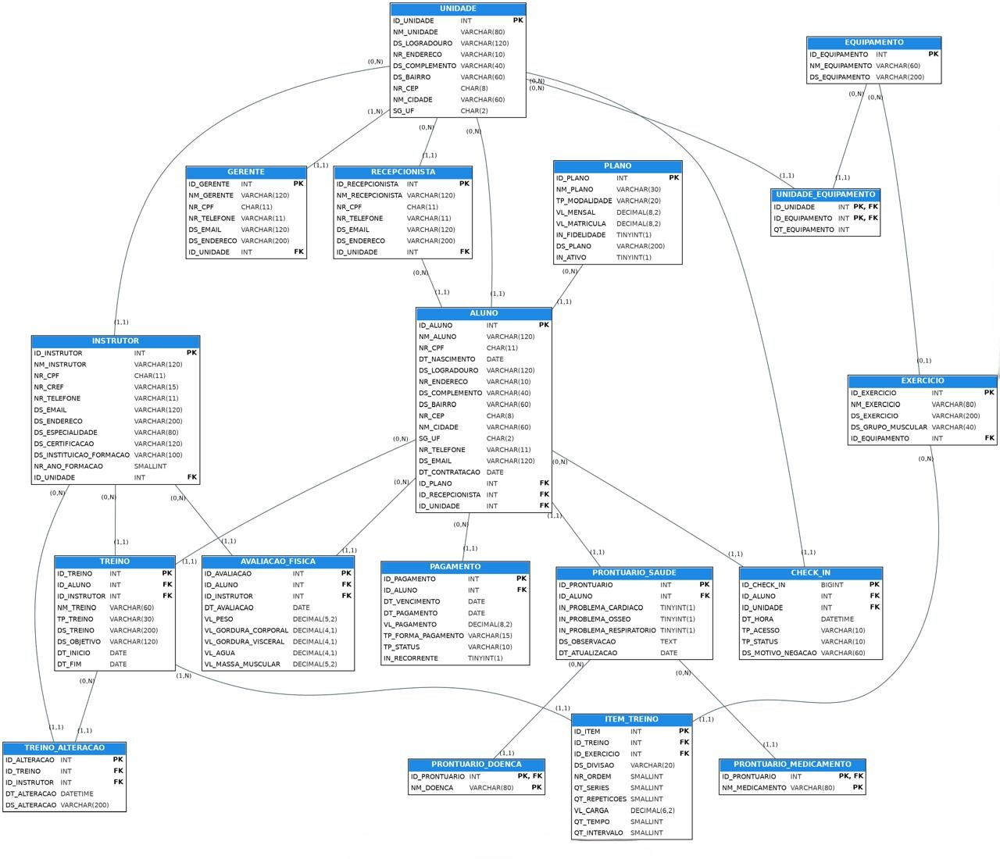

# RedFit — Modelagem de Banco de Dados — Relatório Técnico Final (Entrega 2)

## Integrantes

| Nome completo | RGM | Usuário do GitHub |
|---|---|---|
| Cauã Macedo Santana Cabral | 48124338 |  |
| Gustavo Ribeiro Totino | 48263745 |  |
| Marco Aurélio da Silva Lira | 47572701 |  |
| Pedro Henrique da Silva | 48165191 |  |
| Suellen de Araujo Santos Pimenta | 48122360 |  |

**Curso:** Análise e Desenvolvimento de Sistemas / Ciência da Computação · **Disciplina:** Modelagem de Banco de Dados

## Artefatos do repositório

| Artefato | Arquivo |
|---|---|
| Levantamento (entrevista e observação) | [levantamento/](levantamento/levantamento.md) |
| DER conceitual revisado | [diagramas/](diagramas/DER_conceitual_revisado.png) |
| Modelo lógico | [diagramas/](diagramas/modelo_logico.png) |
| Dicionário de dados (HTML) | [dicionario/](dicionario/dicionario_de_dados.html) |
| Script SQL completo (MySQL) com massa de dados | [docs/](docs/script.sql) |
| Página de planos da unidade (fonte dos planos e preços) | [evidencias/](evidencias/pagina_planos_neo_quimica_arena.html) |
| Evidências (fotos JPG/PNG) | [evidencias/](evidencias/) |
| Slides da apresentação | [apresentação/](docs/script.sql) |

---

# 1. Relatório Técnico

## 1.1 Caracterização da organização

**Nome e natureza.** RedFit, rede de academias de musculação (empresa privada, com fins lucrativos). A unidade estudada é a RedFit Neo Química Arena (Av. Miguel Ignácio Curi, 111, 10º andar, Itaquera, São Paulo – SP, CEP 08220-000).

**Contexto e porte (números informados na entrevista).**

| Item | Número |
|---|---|
| Unidades da rede | 23 |
| Alunos ativos na unidade estudada | uma média de 2500 alunos |
| Alunos por dia na unidade estudada | em média 500 por dia |
| Equipe da unidade | 2 gerentes, 2 recepcionistas, 4 instrutores e 2 pessoas na limpeza (informado pelo gerente) |
| Planos | 3 (RED, Anual e FIT), conforme a página de planos da unidade: RED R$ 9,90 no 1º mês (depois R$ 139,90, confirmado pelo gerente), sem fidelidade e sem matrícula; Anual R$ 89,90/mês com matrícula de R$ 49,90; FIT R$ 119,90/mês com fidelidade e matrícula de R$ 49,90 |
| Formas de pagamento | Planos recorrentes: cartão de crédito, cobrado todo mês, com renovação automática. Na recepção (diárias, quando não se trata de plano): somente Pix e cartão de débito |
| Horário de funcionamento | Segunda a sexta, 6h às 23h; sábado, domingo e feriados, 10h às 16h |
| Benefícios corporativos aceitos | Wellhub (Gympass), TotalPass e Gurupass |

**Problemas e necessidades (gestão de informações).** O gerente relata divergência de nome e de dados básicos (que atrapalha a cobrança e o registro do aluno), cadastro separado por unidade (ele quer um cadastro único), controle de frequência (dia e horário de cada entrada, usado para saber se o aluno treina, inclusive em outras unidades) dependência da internet no sistema e na catraca e, pela observação do grupo, consultas feitas um item por vez no software atual. Cada problema está ligado às tabelas e consultas da rastreabilidade.

| Código | Problema | Como o modelo resolve |
|---|---|---|
| P1 | Controle de frequência e de horários de uso: a academia registra dia e horário das entradas para verificar se o aluno realmente treina (inclusive em outras unidades) e quando a demanda se concentra; a catraca depende da internet, e o grupo observou dificuldade e travamentos ao registrar o Face ID. O banco não corrige a catraca nem o cadastro biométrico, mas registra os acessos, com o motivo de cada acesso negado (inclusive falha de reconhecimento), para analisar horários e resultados. |
| P2 | Controle de mensalidades e inadimplência: a cobrança é automática todo mês; quando falha, fica registrada como atraso e o aluno regulariza na recepção. No plano RED o atraso bloqueia a catraca; nos planos Anual e FIT apenas aparece a pendência. |
| P3 | Divergências nos dados cadastrais e ausência de um cadastro centralizado entre unidades dificultam a gestão e podem gerar inconsistências. A ficha médica em papel também exige cuidado no tratamento dos dados de saúde. |
| P4 | Consulta fragmentada no software atual: o grupo observou que, para ver pendências de pagamento ou o treino do aluno, é preciso voltar ao menu inicial e abrir um item por vez, sem reunir plano de pagamento e treino. O banco reúne plano, pagamentos e treino vigente do aluno numa única consulta. |

**Escopo do sistema.** O banco reúne os dados selecionados da unidade: alunos, planos/contratos, pagamentos, acessos, saúde, avaliações físicas, treinos, exercícios, equipamentos, unidades e profissionais. A entrevista cita sistema próprio, sistema parceiro Eva e dependência de internet; a integração técnica entre esses sistemas e a catraca não foi especificada. Os problemas acima não restringem o modelo a um setor.

**Justificativa da escolha.** A RedFit reúne processos distintos e interligados (cadastro, saúde, plano, pagamento, acesso, avaliação, treino e equipamentos), o que permite aplicar toda a modelagem com cardinalidades variadas. Um integrante do grupo frequenta a unidade diariamente e é amigo do gerente, o que facilitou o acesso. Esse vínculo não substitui a comprovação abaixo.

**Evidências da organização.**
- Endereço da unidade: Av. Miguel Ignácio Curi, 111, 10º andar, Itaquera, São Paulo – SP, CEP 08220-000.
- Perfil da unidade no Google Maps: [RedFit Academia — Neo Química Arena](https://www.google.com/maps/place/REDFIT+Academia+-+Neo+Qu%C3%ADmica+Arena+-+SP/@-23.545562,-46.4776382,17z/data=!3m1!4b1!4m6!3m5!1s0x94ce677885731389:0xea7cfb187022485e!8m2!3d-23.5455669!4d-46.4750633!16s%2Fg%2F11hkwwgmhl).
- Responsável: Guilherme Nogueira, gerente da unidade. Contato: WhatsApp da unidade (11) 93622-0732 e sac@redfit.com.br, conforme a página da unidade (o telefone direto do gerente não pode ser informado).
- Página de planos da unidade (endereço, horário, contato, planos e preços): [`evidencias/pagina_planos_neo_quimica_arena.html`](evidencias/pagina_planos_neo_quimica_arena.html).
- Foto da entrevista no local, com o gerente da unidade, tirada em 31/08/2026, na entrevista, com o integrante Marco Aurélio: [`evidencias/foto_entrevista_gerente.jpg`](evidencias/foto_entrevista_gerente.jpg).
- Imagens de divulgação da unidade (não foram tiradas pelo grupo; servem para ilustrar o local, e a comprovação de acesso é a foto da entrevista). O cartaz "RedPass" que aparece na fachada era uma promoção da inauguração e não existe mais.

### Relato das entrevistas

> **Critério de atualização:** os planos, preços e condições seguem a página de planos da rede de academias(referência), a decisão do grupo está registrada na seção 6 do [levantamento](levantamento/levantamento.md). O que ainda não foi reconfirmado fica como pendência, sem ser apresentado como fato.

- **Quem:** 1° entrevista, com Guilherme Nogueira (gerente da unidade) e o integrante Marco Aurélio da Silva Lira; 2° entrevista, com o mesmo gerente e os integrantes Marco Aurélio da Silva Lira e Suellen de Araujo Santos Pimenta.
- **Quando e onde:** entrevista 1 em 31/08/2026 e entrevista 2 em 30/10/2026, ambas na própria unidade (Av. Miguel Ignácio Curi, 111, 10º andar, Itaquera, São Paulo – SP, CEP 08220-000).
- **Comprovação:** foto tirada em 31/08/2026, na entrevista 1, em `evidencias/foto_entrevista1_gerente.jpg` e foto tirada em 30/10/2026, na entrevista 2, em `evidencias/foto_entrevista2_gerente.jpg` (ver evidências).
- **Achados da entrevista 1 (respostas do gerente):**
  - cadastro com nome, CPF (identificador único), data de nascimento, e-mail e telefone; quem usa o aplicativo gera um código de check-in; o aluno também preenche o prontuário;
  - o plano antigo é cancelado quando o aluno troca de plano e o novo é registrado como vigente, "praticamente um novo contrato"; o aluno pode ainda cancelar ou migrar para aplicativos parceiros;
  - uma pessoa só pode ter dois planos quando um deles é a bioimpedância (um de treino e outro só para a máquina);
  - pagamento recorrente exige cartão de crédito e é cobrado automaticamente todo mês; se falha, fica registrado como atraso e o aluno regulariza na recepção; diárias eram citadas com Pix, dinheiro, débito ou crédito (depois o gerente informou que na recepção só se aceitam Pix e débito; o crédito é a cobrança mensal do plano); valor, data e forma são registrados para contestação e controle de caixa;
  - treinos montados pelos professores conforme o objetivo, por grupo muscular e por dia, com prazo de um a dois meses; geralmente o treino antigo é retirado; fica registrado quem elaborou e quem alterou;
  - frequência registrada com dia e horário, para controle (inclusive de quem treina em outras unidades) e para entender pedidos de cancelamento;
  - avaliação física só pela bioimpedância (parceria MyNutri), com histórico no aplicativo e cerca de uma avaliação por mês;
  - dificuldades: divergência de nome e de dados básicos; desejo de um cadastro único entre unidades; sistema e catraca dependem da internet; o sistema parceiro é o Eva.
- **Achados da entrevista 2 (perguntas e respostas):**
  - o cadastro exige CPF, nome completo, data de nascimento, endereço e telefone; a data comprova se o aluno é maior ou menor de idade e o endereço serve para proximidade e emergência;
  - o prontuário registra problemas cardíacos, ósseos e respiratórios, doença hereditária na família e uso de medicação específica;
  - sobre agendamento: o gerente disse que não há aulas para agendar; a unidade não tem mais aulas coletivas e o serviço é exclusivamente de academia (as aulas anunciadas no site existem em outras unidades da rede);
  - instrutores: nome, CPF, endereço, telefone, dados de formação (onde e em que ano se formou), diploma e carteirinha do CREF; recepcionistas: nome, CPF, endereço e telefone;
  - a rede tem 26 unidades; o plano de acesso à rede toda vale em todas, e o FIT, só na unidade registrada;
  - check-in por digital ou Face ID, à escolha do aluno; quando o acesso vem de parceiros como o TotalPass, a unidade recebe um alerta no aplicativo da academia para autorizar a entrada;
  - os planos de treino ficam armazenados nas fichas dos alunos, e é necessário registrar quem criou ou alterou cada treino, para o aluno ter acompanhamento mais completo;
  - os equipamentos são cadastrados para a montagem dos treinos: ao escolher o grupo muscular (pernas, costas, ombro, peito), o sistema mostra os equipamentos disponíveis na unidade;
  - apenas gerentes excluem dados dos alunos; gerentes e recepção alteram dados (por exemplo, endereço ou telefone).
- **Achados da página de planos da rede de academias:** três planos (RED, Anual e FIT) com os preços, matrículas e condições da seção 3 do levantamento; horário de funcionamento; contato por WhatsApp e e-mail; benefícios corporativos Wellhub, TotalPass e Gurupass; renovação automática e app Redfit em todos os planos.
- **Observação presencial** (o que o grupo viu no local, separado do que foi dito): (a) dificuldade para registrar o Face ID do aluno, com travamentos durante o cadastro; (b) para consultar pendências de pagamento ou tipos de treino é preciso voltar ao menu inicial e abrir um item por vez: o software atual não faz várias consultas ao mesmo tempo e não mostra treino e plano de pagamento juntos. Data(s) e integrantes presentes: em 31/08/2026 com o integrante Marco Aurélio da Silva Lira.
- O levantamento completo, com as divergências entre as fontes e a decisão do grupo, está em [levantamento/levantamento.md](levantamento/levantamento.md).

**Divergências ainda abertas** (detalhes e decisões no levantamento): a entrevista 2 cita o plano "Pro" e diz que o Fit não tem fidelidade, o que contradiz a página; seguimos a página. A menção a aulas coletivas na página de planos vale para outras unidades da rede: o gerente confirmou que a unidade Neo Química Arena não tem mais aulas.

### Processos de negócio

| Processo | O que acontece e quais dados envolve |
|---|---|
| Cadastro e matrícula | O aluno informa nome completo, CPF (identificador único), data de nascimento, endereço e telefone, que são obrigatórios; e-mail é coletado para avisos. O cadastro pode ser feito pelo celular na contratação online e a unidade também recebe o código de check-in de quem usa o aplicativo. O aluno preenche o prontuário de saúde (problemas cardíacos, ósseos e respiratórios, doença hereditária e medicação). Cada unidade mantém um cadastro próprio, e a divergência de nomes e dados básicos atrapalha cobrança e registro; o gerente quer um cadastro único. |
| Contratação do plano e cobrança | O aluno escolhe entre RED, Anual e FIT (preços, matrícula e fidelidade na seção 3 do levantamento) e paga com cartão de crédito, com renovação automática. A troca de plano cancela o anterior e registra o novo como vigente: em plano com fidelidade pode haver multa; nos demais, cobra-se a diferença. Se o aluno cancela o Anual antes do fim, a multa é a soma das mensalidades que faltam. A bioimpedância pode ser contratada à parte. A cobrança é disparada automaticamente todo mês; se falha, fica registrada como atraso e o aluno regulariza na recepção. Na recepção só se aceitam Pix e cartão de débito (não há boleto); o crédito é a cobrança mensal do plano. Valor, data e forma de cada pagamento são registrados. |
| Controle de acesso | O check-in é feito por digital ou Face ID, à escolha do aluno. Quando o acesso vem de parceiros (Wellhub, TotalPass, Gurupass), a unidade recebe um alerta no aplicativo da academia para autorizar a entrada. São registrados dia e horário da frequência, usada para controle e para entender pedidos de cancelamento. A catraca depende da internet. No plano RED, mensalidade em atraso bloqueia a catraca; nos planos Anual e FIT não há bloqueio, e o sistema só mostra a pendência. |
| Avaliação física | A bioimpedância é realizada por equipamento em parceria com a MyNutri, que mede peso, gordura visceral, água corporal, massa muscular e outros dados; o aplicativo mantém histórico para comparação. O grupo deve confirmar quais campos são efetivamente acessíveis e armazenados no sistema da academia. |
| Montagem e acompanhamento de treinos | Os professores elaboram o treino com base nas necessidades e objetivos do aluno; a organização prioriza grupos musculares e dias. Cada item pode registrar exercício, máquina, séries, repetições, peso/carga e descanso; o prazo costuma ser de um a dois meses. Em geral, o treino antigo é retirado e fica apenas o novo. A entrevista diz que fica registrado quem elaborou o treino e, após alterações, quem realizou a alteração. Mais de um professor pode atuar ao longo do tempo. |
| Exercícios e equipamentos | O catálogo guarda cada exercício com grupo muscular e equipamento (quando houver); cada unidade registra quantos aparelhos de cada tipo possui. |
| Profissionais e unidades | A unidade tem 2 gerentes, 2 recepcionistas, 4 instrutores (professores) e 2 pessoas na limpeza. Instrutores: nome, CPF, endereço, telefone, formação (onde e em que ano), diploma e CREF; recepção e demais funcionários: nome, CPF, endereço e telefone. O modelo contempla gerentes, recepcionistas e instrutores; a equipe de limpeza fica fora do escopo porque não lida com dados que o sistema controla. A academia usa o sistema próprio e o sistema parceiro Eva. |

Fluxogramas dos processos e da integração entre eles: [imagens/](imagens/) (fluxo_1 a fluxo_5, entregues na Entrega 1).

**Processos prováveis não incluídos e por quê.**
- *Aulas coletivas e agendamento:* o gerente informou que a unidade não tem mais aulas coletivas; só há treinos. A página de planos cita as aulas porque outras unidades da rede as oferecem. Por isso o processo não faz parte do escopo.
- *Compra e manutenção de equipamentos:* não foram levantados nesta unidade; a quantidade de aparelhos é registrada, mas o processo de compra e manutenção será confirmado com o gerente e não faz parte do escopo desta entrega.
- *Cancelamento de plano:* as regras comerciais são tratadas em RN20 (RED com aviso de 30 dias; FIT com fidelidade de 12 meses e multa de 20% sobre os meses restantes; Anual com multa igual às mensalidades restantes). Para esta entrega, o registro da contratação e da vinculação do plano será representado provisoriamente em ALUNO, pelos campos ID_PLANO e DT_CONTRATACAO, sob a denominação conceitual de **MATRÍCULA/CONTRATO**. Essa solução permite identificar o plano vigente e a data da contratação, mas não mantém o histórico de contratos anteriores, solicitações de cancelamento ou trocas de plano. A limitação fica registrada porque o fluxo administrativo completo é conduzido pela rede/central e não foi detalhado pela equipe da unidade.

### Requisitos

**Requisitos funcionais**

| Código | Requisito |
|---|---|
| RF01 | Cadastrar aluno com nome completo, CPF, data de nascimento, endereço (logradouro, número, complemento, bairro, CEP, cidade, UF), telefone, e-mail (opcional), unidade de matrícula, recepcionista responsável pelo cadastro, plano e data de contratação. |
| RF02 | Consultar e atualizar os dados cadastrais do aluno. |
| RF03 | Registrar o prontuário de saúde: problema cardíaco, ósseo e respiratório (sim/não), doenças hereditárias (lista), medicamentos em uso (lista), observação e data da última atualização. |
| RF04 | Cadastrar planos com nome, abrangência, valor mensal, valor da matrícula, indicador de fidelidade, descrição e indicador de ativo. |
| RF05 | Registrar pagamentos com aluno, vencimento, valor, forma, situação, recorrência e data de pagamento quando aplicável; a entrevista confirma registro de valor, data e forma para controle de caixa/contestação. Planos recorrentes exigem cartão de crédito. Na recepção só se aceitam Pix e cartão de débito; o crédito é usado na cobrança mensal do plano; não há boleto. |
| RF06 | Registrar cada acesso (check-in) com aluno, unidade, data e hora, forma de acesso (digital, Face ID ou autorização pelo aplicativo para acessos de parceiros), resultado (liberado ou negado) e, se negado, o motivo. |
| RF07 | Negar o acesso do aluno do plano RED com mensalidade em atraso, consultando a situação do pagamento; nos demais planos, apenas exibir que há pendências. |
| RF08 | Cadastrar gerentes, recepcionistas e instrutores (nome, CPF, telefone, e-mail; instrutor também CREF, especialidade e certificação) vinculados a uma unidade. |
| RF09 | Registrar avaliação física com aluno, instrutor, data, peso, gordura corporal, gordura visceral, água corporal e massa muscular. |
| RF10 | Cadastrar treino vinculado ao aluno e registrar o profissional que o elaborou/alterou, nome, tipo, descrição, objetivo, data de início e de término, se esses campos forem confirmados no levantamento. O modelo deve permitir atuação de mais de um professor ao longo do tempo. |
| RF11 | Compor o treino com itens: exercício, séries, repetições, carga/peso, tempo e intervalo/descanso. A entrevista diz que o treino é organizado por grupo muscular e por dia; o grupo deve decidir onde representar esses dados (por exemplo, em TREINO/ITEM_TREINO) e alinhar DER, modelo lógico, dicionário e SQL. |
| RF12 | Registrar a substituição do treino conforme a rotina relatada. A entrevista informa que geralmente o treino antigo é retirado e fica apenas o novo; manter histórico é uma melhoria proposta, não uma prática atual confirmada. O grupo deve decidir e justificar se o banco proposto preservará histórico como requisito futuro. |
| RF13 | Cadastrar exercícios com nome, descrição, grupo muscular e equipamento (opcional). |
| RF14 | Cadastrar equipamentos e a quantidade de cada tipo em cada unidade. |
| RF15 | Cadastrar as unidades com nome e endereço. |
| RF16 | Consultar acessos por hora, dia da semana e unidade, e acessos negados por motivo (problema P1). |
| RF17 | Consultar mensalidades em atraso, taxa de inadimplência, formas de pagamento e receita por mês e por plano (problema P2). |
| RF18 | Apoiar a consulta controlada dos dados cadastrais centralizados entre unidades e, se estiver no escopo, das restrições de saúde necessárias ao atendimento, respeitando a LGPD. Vincular este requisito ao problema correto após a revisão da rastreabilidade. |
| RF19 | Consultar alunos sem acesso em um período e a carga de treinos e avaliações por instrutor. |
| RF20 | Executar consultas de auditoria das regras de negócio (RN07, RN11, RN12, RN16, RN18 e RN22). |
| RF21 | Consultar, numa única consulta, os dados do aluno com o plano contratado, a situação dos pagamentos (inclusive pendências) e o treino vigente com seus itens (problema P4). |

**Requisitos não funcionais**

| Código | Categoria | Requisito |
|---|---|---|
| RNF01 | Segurança e privacidade | Dados pessoais e de saúde protegidos conforme a LGPD; dados de saúde são sensíveis. |
| RNF02 | Controle de acesso | Operações restritas por perfil: exclusões apenas por gerentes; alterações por gerentes e recepção. |
| RNF03 | Integridade | Chaves estrangeiras e restrições CHECK garantem a consistência entre as tabelas. |
| RNF04 | Disponibilidade | Sistema disponível aos funcionários durante o funcionamento das unidades. |
| RNF05 | Desempenho | Check-in e consulta do treino devem responder em tempo adequado, apoiados por índices. |
| RNF06 | Escalabilidade | Suportar as 26 unidades, mais alunos, planos e equipamentos sem mudar a estrutura. |
| RNF07 | Usabilidade | Cadastros compreensíveis pela recepção e pelos instrutores; consultas que reúnem plano, pagamento e treino sem voltar ao menu inicial (observação do grupo no software atual). |
| RNF08 | Manutenibilidade | Um único padrão de nomes e documentação (dicionário versionado). |

**Requisitos prováveis não incluídos.** Aplicativo do aluno, agendamento de aulas e integração técnica com a catraca e com aplicativos parceiros ficou fora: a unidade não oferece aulas para agendamento; a integração técnica com a catraca não foi detalhada.

### Regras de negócio

| Código | Regra |
|---|---|
| RN01 | Todo aluno tem nome completo, CPF único, data de nascimento, endereço e telefone. |
| RN02 | A data de nascimento identifica se o aluno é menor ou maior de idade. |
| RN03 | O endereço é solicitado para verificar proximidade e para emergências. |
| RN04 | Cada aluno tem, em regra, um plano de treino ativo por vez; a bioimpedância pode ser contratada separadamente, permitindo um plano de treino e outro serviço de bioimpedância. A entrevista também menciona mudança para aplicativos parceiros. |
| RN05 | Todo pagamento deve ser associado ao aluno e ao que está sendo pago; normalmente corresponde à matrícula/plano, mas pode abranger plano de treino e bioimpedância quando contratados juntos. |
| RN06 | Todo acesso é registrado com aluno, unidade, data e hora, forma de acesso e resultado; acesso negado exige motivo. |
| RN07 | As informações de saúde do aluno ficam no prontuário, um por aluno. |
| RN08 | Todo aluno é cadastrado por um recepcionista. |
| RN09 | Toda avaliação física pertence a um aluno e é realizada por um instrutor. |
| RN10 | Todo treino pertence a um aluno e tem um instrutor responsável. |
| RN11 | O treino é composto por itens; cada item refere-se a um exercício com séries, repetições, carga/peso, tempo e intervalo/descanso. A organização por dia e grupo muscular foi mencionada na entrevista e precisa ser representada ou justificada como fora do escopo. |
| RN12 | Na rotina descrita na entrevista, ao atualizar o treino geralmente o antigo é retirado e fica apenas o novo. A preservação do histórico é uma decisão/proposta do modelo, não uma prática atual confirmada. |
| RN13 | Cada exercício pode usar um equipamento (opcional). |
| RN14 | Todo instrutor tem registro no CREF. |
| RN15 | A unidade Neo Química Arena não tem mais aulas coletivas e não há agendamento; só existem treinos (as aulas anunciadas no site são de outras unidades da rede). |
| RN16 | A mensalidade em atraso bloqueia a catraca do aluno do plano RED (cobrança mensal); nos planos Anual e FIT não há bloqueio, o sistema apenas mostra a pendência. |
| RN17 | Aluno menor de idade só treina na presença do responsável (restrição organizacional; não verificável no banco). |
| RN18 | Plano recorrente exige cartão de crédito, cobrado todo mês. Na recepção só se aceitam Pix e cartão de débito. Não há pagamento por boleto. |
| RN19 | Matrícula: RED não tem (grátis); FIT e Anual têm matrícula de R$ 49,90, cobrada no primeiro mês. Mensalidades: RED R$ 9,90 no 1º mês e depois R$ 139,90; Anual R$ 89,90; FIT R$ 119,90. Os três planos incluem acesso a todas as unidades; o FIT tem treino exclusivo na unidade de compra. RED e Anual permitem treinar com 5 amigos; o FIT não inclui amigos. |
| RN20 | RED não tem fidelidade e exige pedido de cancelamento com 30 dias de antecedência; caso contrário, pode ser cobrada mais uma mensalidade. FIT tem fidelidade de 12 meses; o cancelamento antecipado gera multa de 20% sobre os meses restantes (maior quanto mais cedo o cancelamento). No Anual, a multa é a soma das mensalidades que faltam para terminar o ano de contrato (exemplo do gerente: em junho faltam 6 meses, então a multa é o valor dessas 6 mensalidades). Na troca de plano, plano com fidelidade pode gerar multa; nos demais, cobra-se a diferença entre os planos. Todos os planos têm renovação automática. |
| RN21 | O check-in é feito por digital ou Face ID, à escolha do aluno; acessos de parceiros (Wellhub, TotalPass, Gurupass) exigem autorização da unidade por alerta no aplicativo. A implementação técnica da catraca não foi especificada. |
| RN22 | Toda unidade tem ao menos um gerente. |
| RN23 | Gerentes, recepcionistas, instrutores e alunos pertencem a uma unidade. |
| RN24 | Somente gerentes podem excluir dados; gerentes e recepção podem alterar dados cadastrais dos alunos (por exemplo, endereço e telefone). |

**Restrições legais e organizacionais.** A LGPD exige cuidado com dados pessoais e especialmente com dados de saúde. O acesso às informações deve ser restrito aos perfis autorizados. Os planos RED, Anual e FIT incluem acesso a todas as unidades, e o FIT tem treino exclusivo na unidade de compra; amigos só no RED e no Anual (RN19).

**Regras prováveis não incluídas.** *Atestado médico para a prática de atividade:* não foi levantado. O fluxo operacional do cancelamento não foi informado em detalhe.

### Notação e software do DER

O DER segue a notação do brModelo: entidades em retângulos, relacionamentos em losangos, cardinalidade (mín,máx) dos dois lados, identificadores e atributos de relacionamento ligados ao losango, sem chaves estrangeiras. O diagrama final deve ser produzido/validado no brModelo, conforme a notação exigida pelo esqueleto. Arquivo-fonte do brModelo (.brM3 ou formato usado pela versão instalada): **PREENCHER pelo grupo**. Não declarar Graphviz como software final exigido; se foi usado apenas como rascunho, identificar isso explicitamente.

**Decisão de modelagem: entidades separadas.** O grupo manteve GERENTE, INSTRUTOR e RECEPCIONISTA como entidades independentes, sem generalização FUNCIONARIO: cada cargo tem atributos e responsabilidades próprias (CREF e especialidade do instrutor; cadastro de alunos pela recepção; administração da unidade pelo gerente). Alternativa considerada: generalização, útil se os atributos comuns crescerem; para o escopo atual duplica poucas colunas e simplifica as consultas.

### Caso A — mesma organização da Entrega 1: apontamentos da correção

| Apontamento da correção da E1 | O que mudou no trabalho | Por quê |
|---|---|---|
| Organização real não demonstrada | Endereço, link do perfil no Google, responsável com nome, data da entrevista e foto no repositório | Comprovar existência e acesso |
| Contato e entrevista sem comprovação | Relato da entrevista (quem, quando, onde) e arquivo de levantamento | Mostrar como as informações foram obtidas |
| Problemas sem dificuldade concreta | P1, P2 e P3 numerados, cada um ligado a tabelas e consultas | O problema precisa ser resolvido pelo modelo |
| Justificativa genérica e sem evidências | Vínculo declarado e evidências | Transparência sobre o acesso |
| Processos escritos como requisitos, sem fluxo | Processos com dados envolvidos, cinco fluxogramas e integração; processos não incluídos justificados | Exigência de fluxo e de cobertura |
| Requisitos genéricos (CRUD) | RF com todos os campos e ligados aos problemas | Nível de detalhe exigido |
| Regras sem restrições organizacionais e "a confirmar" | RN01–RN23 com códigos; restrições legais e organizacionais separadas | Regras citadas nas justificativas e nas consultas de auditoria |
| Dicionário só com atributos | Dicionário completo no formato do modelo (fluxo, convenções, tipos, índices, log, acesso e LGPD) | Atende ao modelo do professor |
| DER sem cardinalidade mínima | (mín,máx) nos dois lados de todos os relacionamentos | Exigência da notação brModelo |
| Relacionamentos com um lado só (faz, possui, realiza) | Todos com dois lados e 1:N coerentes (aluno 1:N avaliação, aluno 1:N treino) | O 1:1 impedia o histórico |
| AVALIAÇÃO FÍSICA sem atributos | Sete atributos de medidas, data e vínculos | Sem atributos não há o que registrar |
| PLANO ligado ao PRONTUÁRIO | PLANO ligado ao ALUNO (`contrata`, com DT_CONTRATACAO) | Quem contrata é o aluno |
| FK (ID_EXERCICIO) dentro de APARELHO | Removida do conceitual; EQUIPAMENTO 1:N EXERCICIO | FK só aparece no modelo lógico |
| EXERCÍCIO acumulava atributos de item | Entidade ITEM_TREINO (séries, repetições, carga, tempo, intervalo) | Separa catálogo de prescrição |
| grupo_muscular e equipamento em APARELHO | DS_GRUPO_MUSCULAR em EXERCICIO; EQUIPAMENTO é catálogo | O exercício trabalha o músculo |
| README e DER divergentes (PAGAMENTO, UNIDADE, CHECK_IN, ITEM_TREINO ausentes) | 14 entidades no conceitual, iguais no README, no dicionário e no DER | Consistência |
| "Aula/Treino" e "Aparelho" | TREINO e EQUIPAMENTO | A RedFit não tem aulas |
| MATRÍCULA/CONTRATO | Para esta entrega, a matrícula/contrato será representada provisoriamente em ALUNO, pelos campos ID_PLANO e DT_CONTRATACAO, sem criar uma tabela independente. | A entrevista confirmou que a troca de plano encerra o vínculo anterior e registra um novo como vigente, mas a unidade não detalhou os dados e as etapas administrativas do contrato. A solução provisória registra o plano vigente e a data de contratação, sem histórico de contratos anteriores; a limitação deverá ser revista quando houver informações suficientes da rede/central. |
| Justificativa técnica sem alternativas | Seção 1.5 com alternativas e regras citadas | Defender as decisões |
| Uso de IA sem os 8 itens | Seção 5 com os itens por uso | Documentação obrigatória |
| HTML com notas de IA não revisadas | Notas removidas; dicionário em HTML único | Entrega profissional |

**Mudanças feitas nesta entrega (revisão para o modelo lógico).**

| Mudança | Por quê |
|---|---|
| Entidade GERENTE; vínculos de gerente, instrutor, recepcionista e aluno com UNIDADE | A rede tem 26 unidades e a unidade tem 2 gerentes; permite consultas por unidade e a regra RN22 |
| Endereço do aluno e da unidade em colunas separadas | Evita atributo composto e permite filtrar por bairro e CEP |
| Doenças hereditárias e medicamentos como listas (tabelas próprias) | São multivalorados; 1FN |
| PLANO ganha VL_MATRICULA e IN_FIDELIDADE | Representam RN19 e RN20 |
| PAGAMENTO ganha DT_VENCIMENTO, DT_PAGAMENTO e registro de valor/forma/situação | Representa controle de cobrança, atraso e conferência/controle de caixa (P2) |
| CHECK_IN ganha DS_MOTIVO_NEGACAO | Distinguir inadimplência de falha do reconhecimento (P1) |
| Unidades de medida definidas (kg, %, segundos) | Eliminam o "unidade a definir" do dicionário preliminar |

## 1.2 Conversão do Modelo Conceitual para o Modelo Lógico

**Entidades → tabelas.** Cada entidade virou uma tabela; as relações N:M e os atributos multivalorados geraram tabelas adicionais (17 no total).

| Entidade | Tabela | Colunas | Observação |
|---|---|---|---|
| UNIDADE | UNIDADE | 9 |  |
| GERENTE | GERENTE | 6 | entidade independente, por decisão do grupo (sem generalização) |
| RECEPCIONISTA | RECEPCIONISTA | 6 | id, nome, CPF, telefone, e-mail e unidade |
| INSTRUTOR | INSTRUTOR | 9 | id, nome, CPF, telefone, e-mail, CREF, especialidade, certificação e unidade |
| PLANO | PLANO | 8 |  |
| ALUNO | ALUNO | 17 | DS_ENDERECO foi dividido em 7 colunas (1FN); recebe ID_PLANO e DT_CONTRATACAO (relação `contrata`) |
| PRONTUARIO_SAUDE | PRONTUARIO_SAUDE | 7 | atributos multivalorados DS_DOENCA_HEREDITARIA e DS_MEDICAMENTO viraram as tabelas abaixo |
| PRONTUARIO_DOENCA | PRONTUARIO_DOENCA | 2 | nova: criada pela 1FN (multivalorado) |
| PRONTUARIO_MEDICAMENTO | PRONTUARIO_MEDICAMENTO | 2 | nova: criada pela 1FN (multivalorado) |
| AVALIACAO_FISICA | AVALIACAO_FISICA | 9 |  |
| EQUIPAMENTO | EQUIPAMENTO | 3 |  |
| EXERCICIO | EXERCICIO | 5 |  |
| UNIDADE_EQUIPAMENTO | UNIDADE_EQUIPAMENTO | 3 | nova: tabela associativa da relação N:M `dispõe de` |
| TREINO | TREINO | 9 |  |
| ITEM_TREINO | ITEM_TREINO | 8 |  |
| CHECK_IN | CHECK_IN | 7 |  |
| PAGAMENTO | PAGAMENTO | 8 |  |

**Atributos → colunas.** Atributo simples vira coluna com o tipo físico do dicionário; atributo composto (DS_ENDERECO) vira várias colunas; atributo multivalorado vira tabela própria; atributo de relacionamento 1:N vai para a tabela do lado N (DT_CONTRATACAO em ALUNO), e o de N:M vai para a tabela associativa (QT_EQUIPAMENTO).

**Relacionamentos → chaves e cardinalidades.**

| Relacionamento | Entidades e cardinalidades | Como virou chave |
|---|---|---|
| registra | RECEPCIONISTA (0,N) — ALUNO (1,1) | ALUNO.ID_RECEPCIONISTA |
| contrata | PLANO (0,N) — ALUNO (1,1) | ALUNO.ID_PLANO (+ DT_CONTRATACAO em ALUNO) |
| possui | ALUNO (1,1) — PRONTUARIO_SAUDE (1,1) | PRONTUARIO_SAUDE.ID_ALUNO (UNIQUE, garante o 1:1) |
| realiza | ALUNO (0,N) — AVALIACAO_FISICA (1,1) | AVALIACAO_FISICA.ID_ALUNO |
| aplica | INSTRUTOR (0,N) — AVALIACAO_FISICA (1,1) | AVALIACAO_FISICA.ID_INSTRUTOR |
| tem | ALUNO (0,N) — TREINO (1,1) | TREINO.ID_ALUNO |
| elabora | INSTRUTOR (0,N) — TREINO (1,1) | TREINO.ID_INSTRUTOR |
| compõe-se de | TREINO (1,N) — ITEM_TREINO (1,1) | ITEM_TREINO.ID_TREINO (CASCADE) |
| é prescrito em | EXERCICIO (0,N) — ITEM_TREINO (1,1) | ITEM_TREINO.ID_EXERCICIO |
| é usado em | EQUIPAMENTO (0,N) — EXERCICIO (0,1) | EXERCICIO.ID_EQUIPAMENTO (aceita NULL: cardinalidade mínima 0) |
| dispõe de | UNIDADE (0,N) — EQUIPAMENTO (0,N) | tabela associativa UNIDADE_EQUIPAMENTO (PK composta + QT_EQUIPAMENTO) |
| efetua | ALUNO (0,N) — CHECK_IN (1,1) | CHECK_IN.ID_ALUNO |
| recebe | UNIDADE (0,N) — CHECK_IN (1,1) | CHECK_IN.ID_UNIDADE |
| paga | ALUNO (0,N) — PAGAMENTO (1,1) | PAGAMENTO.ID_ALUNO |
| gerencia | UNIDADE (1,N) — GERENTE (1,1) | GERENTE.ID_UNIDADE |
| possui instrutor | UNIDADE (0,N) — INSTRUTOR (1,1) | INSTRUTOR.ID_UNIDADE |
| possui recepcionista | UNIDADE (0,N) — RECEPCIONISTA (1,1) | RECEPCIONISTA.ID_UNIDADE |
| matricula | UNIDADE (0,N) — ALUNO (1,1) | ALUNO.ID_UNIDADE |
| (multivalorado) | PRONTUARIO_SAUDE (0,N) — doenças hereditárias | PRONTUARIO_DOENCA.ID_PRONTUARIO (CASCADE) |
| (multivalorado) | PRONTUARIO_SAUDE (0,N) — medicamentos | PRONTUARIO_MEDICAMENTO.ID_PRONTUARIO (CASCADE) |

**Como cada cardinalidade foi tratada.** 1:N: a FK fica na tabela do lado N. 1:1 (aluno e prontuário): FK com restrição UNIQUE. N:N (unidade e equipamento): tabela associativa com PK composta. Cardinalidade mínima 1 no lado N: coluna da FK NOT NULL; mínima 0 (exercício sem equipamento): FK aceita NULL.

**Generalização.** Não há generalização no modelo (decisão do grupo, ver seção 1.1); portanto não houve estratégia de conversão a escolher.

## 1.3 Chaves primárias e estrangeiras

| Tabela | Chave primária | Chaves estrangeiras |
|---|---|---|
| UNIDADE | ID_UNIDADE | — |
| GERENTE | ID_GERENTE | ID_UNIDADE → UNIDADE.ID_UNIDADE |
| RECEPCIONISTA | ID_RECEPCIONISTA | ID_UNIDADE → UNIDADE.ID_UNIDADE |
| INSTRUTOR | ID_INSTRUTOR | ID_UNIDADE → UNIDADE.ID_UNIDADE |
| PLANO | ID_PLANO | — |
| ALUNO | ID_ALUNO | ID_PLANO → PLANO.ID_PLANO; ID_RECEPCIONISTA → RECEPCIONISTA.ID_RECEPCIONISTA; ID_UNIDADE → UNIDADE.ID_UNIDADE |
| PRONTUARIO_SAUDE | ID_PRONTUARIO | ID_ALUNO → ALUNO.ID_ALUNO |
| PRONTUARIO_DOENCA | ID_PRONTUARIO, NM_DOENCA | ID_PRONTUARIO → PRONTUARIO_SAUDE.ID_PRONTUARIO |
| PRONTUARIO_MEDICAMENTO | ID_PRONTUARIO, NM_MEDICAMENTO | ID_PRONTUARIO → PRONTUARIO_SAUDE.ID_PRONTUARIO |
| AVALIACAO_FISICA | ID_AVALIACAO | ID_ALUNO → ALUNO.ID_ALUNO; ID_INSTRUTOR → INSTRUTOR.ID_INSTRUTOR |
| EQUIPAMENTO | ID_EQUIPAMENTO | — |
| EXERCICIO | ID_EXERCICIO | ID_EQUIPAMENTO → EQUIPAMENTO.ID_EQUIPAMENTO |
| UNIDADE_EQUIPAMENTO | ID_UNIDADE, ID_EQUIPAMENTO | ID_UNIDADE → UNIDADE.ID_UNIDADE; ID_EQUIPAMENTO → EQUIPAMENTO.ID_EQUIPAMENTO |
| TREINO | ID_TREINO | ID_ALUNO → ALUNO.ID_ALUNO; ID_INSTRUTOR → INSTRUTOR.ID_INSTRUTOR |
| ITEM_TREINO | ID_ITEM | ID_TREINO → TREINO.ID_TREINO; ID_EXERCICIO → EXERCICIO.ID_EXERCICIO |
| CHECK_IN | ID_CHECK_IN | ID_ALUNO → ALUNO.ID_ALUNO; ID_UNIDADE → UNIDADE.ID_UNIDADE |
| PAGAMENTO | ID_PAGAMENTO | ID_ALUNO → ALUNO.ID_ALUNO |

## 1.4 Processo de Normalização

**1FN — sem grupos repetitivos nem atributos multivalorados ou compostos.**
- DS_DOENCA_HEREDITARIA e DS_MEDICAMENTO guardavam várias informações no mesmo campo; viraram PRONTUARIO_DOENCA e PRONTUARIO_MEDICAMENTO, uma linha por doença ou medicamento.
- DS_ENDERECO continha logradouro, número, bairro, CEP, cidade e UF; foi dividido em colunas atômicas em ALUNO e UNIDADE.
- Itens de treino ficam em ITEM_TREINO (uma linha por exercício), e não em campos repetidos dentro de TREINO.

**2FN — sem dependência parcial da chave composta.** As tabelas com chave composta são PRONTUARIO_DOENCA, PRONTUARIO_MEDICAMENTO (a chave é a própria informação, sem colunas extras) e UNIDADE_EQUIPAMENTO, em que QT_EQUIPAMENTO depende da unidade **e** do equipamento juntos. Nas demais, a chave é simples (ID), então não há dependência parcial. Em ITEM_TREINO foi usado ID_ITEM como PK e UNIQUE (ID_TREINO, ID_EXERCICIO) para impedir repetição do mesmo exercício no treino.

**3FN — sem dependência transitiva.** Dados de outra entidade ficam na tabela dela e são acessados por FK: o nome e o valor do plano ficam em PLANO (não em ALUNO nem em PAGAMENTO); o nome do instrutor fica em INSTRUTOR (não em TREINO ou AVALIACAO_FISICA); o nome da unidade, em UNIDADE (não em CHECK_IN); o equipamento do exercício, em EQUIPAMENTO. Valores derivados não são gravados: idade (calculada pela data de nascimento) e situação de atraso (PENDENTE com vencimento passado). VL_PAGAMENTO é um fato histórico (valor cobrado, que inclui a matrícula no primeiro mês) e não depende do valor vigente do plano, então não é redundante.

**Exceção reconhecida.** Em ALUNO e UNIDADE, o CEP determina logradouro, bairro, cidade e UF, o que é uma dependência transitiva. A tabela de CEPs não foi criada porque exigiria base externa de endereços, fora do escopo; o cadastro mantém o endereço completo informado pelo aluno.

**Justificativa.** A 1FN permite consultar doenças e medicamentos individualmente (P3) e filtrar endereços; a 2FN e a 3FN evitam que mudar o nome de um plano, de uma unidade ou de um instrutor exija atualizar muitas linhas.

## 1.5 Justificativas Técnicas das Decisões

**Chaves primárias.** Foram usados identificadores numéricos próprios (INT AUTO_INCREMENT; BIGINT em CHECK_IN, que cresce mais) em vez de CPF: o CPF é dado pessoal, pode ser corrigido e não existe em todas as tabelas. O CPF fica como UNIQUE (RN01). Nas tabelas associativas e de listas (UNIDADE_EQUIPAMENTO, PRONTUARIO_DOENCA, PRONTUARIO_MEDICAMENTO) a PK é composta pelas FKs, pois a combinação já identifica a linha.

**Chaves estrangeiras.** Cada FK implementa um relacionamento da tabela da seção 1.2. Foram usados `ON DELETE RESTRICT` na maioria (não se apaga um plano, unidade ou aluno em uso: RNF02), e `ON DELETE CASCADE` apenas nos filhos que não existem sozinhos (itens de um treino e listas de um prontuário).

**Restrições aplicadas.**

| Restrição | Onde | Regra |
|---|---|---|
| UNIQUE CPF | ALUNO, GERENTE, RECEPCIONISTA, INSTRUTOR | RN01 |
| UNIQUE e NOT NULL NR_CREF | INSTRUTOR | RN14 |
| UNIQUE ID_ALUNO (1:1) | PRONTUARIO_SAUDE | RN07 |
| FK NOT NULL ID_RECEPCIONISTA | ALUNO | RN08 |
| FK NOT NULL ID_ALUNO e ID_INSTRUTOR | AVALIACAO_FISICA | RN09 |
| FK NOT NULL ID_ALUNO e ID_INSTRUTOR | TREINO | RN10 |
| UNIQUE (ID_TREINO, ID_EXERCICIO); séries e repetições maiores que 0 | ITEM_TREINO | RN11 |
| CHECK DT_FIM nula ou posterior a DT_INICIO | TREINO | RN12 |
| FK ID_EQUIPAMENTO aceita NULL | EXERCICIO | RN13 |
| CHECK status e motivo coerentes; FK ID_ALUNO NOT NULL | CHECK_IN e PAGAMENTO | RN05, RN06 |
| CHECK TP_ACESSO IN ('FACIAL') | CHECK_IN | RN21 |
| CHECK forma de pagamento e situação; PAGO exige DT_PAGAMENTO | PAGAMENTO | RN16, RN18 e RN20 |
| CHECK VL_MATRICULA ≥ 0 e IN_FIDELIDADE em (0,1) | PLANO | RN19, RN20 |
| FK NOT NULL ID_UNIDADE | ALUNO, GERENTE, RECEPCIONISTA, INSTRUTOR | RN22, RN23 |
| CHECK de formato (CPF 11 dígitos, CEP 8, telefone 10 ou 11) | várias | RN01 |
| CHECK percentuais entre 0 e 100; medidas maiores que 0 | AVALIACAO_FISICA | RN09 |

As regras que envolvem mais de uma tabela (RN16, RN18, RN22) e as que dependem de ação humana (RN17) não cabem em CHECK; são verificadas pelas consultas de auditoria A01 a A06.

**Decisões arquiteturais.** (1) Catálogos (PLANO, EXERCICIO, EQUIPAMENTO) separados dos registros que se repetem. (2) A preservação do histórico de treinos é uma melhoria do modelo, pois a entrevista diz que o treino antigo geralmente é retirado. (3) Situação de atraso derivada, não gravada. (4) Dados de saúde em tabelas próprias, com controle de acesso e atenção à LGPD.

## 1.6 Proposta de Arquitetura Analítica para BI e IA

**Informações estratégicas.** Quando e onde a demanda se concentra (dimensionar catracas e equipe); quem está inadimplente e por qual forma de pagamento; quanto se arrecada por plano; quais alunos deixaram de frequentar (risco de evasão); a carga de trabalho dos instrutores; a evolução física dos alunos.

**KPIs.**

| Código | Indicador | Fórmula | Período | Meta (a validar com a gerência) |
|---|---|---|---|---|
| K1 | Acessos por hora | contagem de CHECK_IN por unidade e hora | semanal | nenhum horário acima da capacidade das catracas |
| K2 | Média diária de acessos | acessos ÷ dias da janela, por unidade | semanal | acompanhar tendência |
| K3 | Alunos em atraso | alunos com pagamento pendente vencido | mensal | reduzir mês a mês |
| K4 | Taxa de inadimplência | mensalidades vencidas e pendentes ÷ vencidas | mensal | abaixo de 5% |
| K5 | Receita recebida | soma de VL_PAGAMENTO pagos, por mês e plano | mensal | acompanhar crescimento |
| K6 | Alunos por plano | alunos do plano ÷ total de alunos | mensal | acompanhar mix |
| K7 | Alunos sem acesso em 14 dias | alunos sem CHECK_IN na janela | quinzenal | reduzir |
| K8 | Treinos vigentes por instrutor | treinos sem DT_FIM por instrutor | mensal | distribuição equilibrada |
| K9 | Taxa de acessos negados | negados ÷ total de acessos | diário/semanal | abaixo de 5% |
| K10 | Variação de peso entre avaliações | último peso − primeiro peso, por aluno | trimestral | acompanhar por objetivo |

**Potencial para BI.** O modelo em tabelas de fatos (CHECK_IN, PAGAMENTO, AVALIACAO_FISICA, ITEM_TREINO) e dimensões (ALUNO, PLANO, UNIDADE, INSTRUTOR, EXERCICIO, EQUIPAMENTO, data) alimenta diretamente painéis em ferramentas de BI (acessos por hora e unidade, inadimplência por plano, receita por mês) e comparações entre as 26 unidades.

**Aplicações analíticas e de IA.** Previsão de demanda por hora (série temporal de CHECK_IN) para dimensionar catracas e equipe; modelo de risco de inadimplência e de evasão a partir de PAGAMENTO e da frequência; recomendação de treino a partir do objetivo, da avaliação física e das restrições de saúde; detecção de anomalias em acessos negados (falhas do reconhecimento facial). Essas aplicações exigem mais histórico do que a massa desta entrega.

**Rastreabilidade (problema ou KPI → tabelas → consulta).**

| Problema ou KPI | Tabelas envolvidas | Consulta |
|---|---|---|
| P1 — horários de pico e acessos negados | CHECK_IN, UNIDADE | G01, G02, G03, G04 |
| P2 — mensalidades e inadimplência | PAGAMENTO, ALUNO, PLANO | G05, G06, G07, G08 |
| P3 — cadastro único e consistência cadastral (e dados de saúde, se incluídos no escopo) | PRONTUARIO_SAUDE, ALUNO, TREINO, INSTRUTOR | G09 |
| P4 — consulta fragmentada (plano, pagamentos e treino numa só visão) | ALUNO, PLANO, PAGAMENTO, TREINO, ITEM_TREINO | G14 |
| K1 — acessos por hora | CHECK_IN, UNIDADE | G01, G02 |
| K2 — média diária de acessos | CHECK_IN, UNIDADE | G04 |
| K3 — alunos em atraso | PAGAMENTO, ALUNO, PLANO | G05 |
| K4 — taxa de inadimplência | PAGAMENTO | G06 |
| K5 — receita recebida | PAGAMENTO, ALUNO, PLANO | G08 |
| K6 — alunos por plano | ALUNO, PLANO | G10 |
| K7 — alunos sem acesso | ALUNO, CHECK_IN, PLANO, UNIDADE | G11 |
| K8 — treinos por instrutor | INSTRUTOR, TREINO, AVALIACAO_FISICA, UNIDADE | G12 |
| K9 — acessos negados | CHECK_IN, UNIDADE | G03 |
| K10 — variação de peso | ALUNO, AVALIACAO_FISICA | G13 |

---

# 2. Modelo Lógico Relacional

Diagrama em ['diagramas/modelo_logico.png'](diagramas/modelo_logico.png): 17 tabelas conforme a versão atual do modelo. O modelo lógico final deve ser validado/produzido no software exigido pelo professor (brModelo). **Arquivo-fonte e versão do software: PREENCHER pelo grupo.** Conferir se o PNG corresponde ao arquivo-fonte final. As demais restrições (NOT NULL, UNIQUE, CHECK e DEFAULT) estão no [dicionário de dados](dicionario/dicionario_de_dados.html) e implementadas no script.

# 3. Script SQL Completo

[docs/script.sql](docs/script.sql), para **MySQL 8.0.16 ou superior**. Executa do zero (`mysql -u root -p < docs/script.sql`) e contém, nesta ordem: CREATE DATABASE; 17 CREATE TABLE; constraints (UNIQUE, CHECK e FOREIGN KEY); índices; INSERT da massa de dados; 5 SELECT com JOIN (S01–S05); 4 UPDATE e 2 DELETE; 13 consultas gerenciais (G01–G13); 6 consultas de auditoria (A01–A06). Cada consulta tem cabeçalho com código, pergunta e o problema ou a regra que atende. As consultas gerenciais e de auditoria são as usadas na demonstração.

Teste do script do zero (banco vazio): PREENCHER data e ambiente do teste (ex.: MySQL Workbench do laboratório).

# 4. Massa de Dados

A massa está no próprio script. É fictícia (nomes, CPFs, telefones e e-mails inventados; só o nome e o endereço da unidade 1 são da organização). O gerente informou cerca de 500 alunos por dia na unidade e média de 2500 o total de alunos ativos. Por isso a massa é uma amostra em escala reduzida: os cerca de 670 acessos em 14 dias equivalem a uns 48 por dia, o suficiente para mostrar horários de pico, acessos negados e alunos sem acesso.

| Tabela | Registros | Como o volume real justifica |
|---|---|---|
| UNIDADE | 3 | A unidade estudada e duas fictícias, para mostrar a rede |
| GERENTE, RECEPCIONISTA, INSTRUTOR | 3, 4, 8 | A unidade 1 tem a equipe real informada pelo gerente: 2 gerentes, 2 recepcionistas e 4 instrutores; as outras unidades têm equipes menores. |
| PLANO | 3 | Os três planos reais |
| ALUNO | 150 | 120 na unidade 1 como amostra para demonstração, 20 e 10 nas unidades fictícias; o gerente não tem o total de alunos ativos, então não há proporção a justificar |
| CHECK_IN | 669 | Massa sintética de acessos distribuídos em 14 dias; não representa necessariamente o volume real da unidade |
| PAGAMENTO | 429 | 3 meses de mensalidade por aluno (agosto a outubro de 2026) |
| AVALIACAO_FISICA | 157 | 0, 1 ou 2 avaliações por aluno ao longo de 2026 |
| TREINO e ITEM_TREINO | 179 e 1065 | Um treino vigente por aluno, parte com treino anterior encerrado, de 5 a 7 exercícios cada |
| PRONTUARIO_SAUDE, DOENCA, MEDICAMENTO | 148, 13, 13 | Um prontuário por aluno, com poucos casos de doença e medicamento |
| EQUIPAMENTO, EXERCICIO, UNIDADE_EQUIPAMENTO | 6, 18, 18 | Os 6 tipos de equipamento informados e um catálogo de exercícios |

**Variedade de situações** (massa sintética para testar consultas): alunos nos planos FIT, RED e Anual; 5 menores de idade; 15 alunos com mensalidade em atraso; pagamentos na recepção por Pix e débito e mensalidades recorrentes no crédito (sem boleto); acessos liberados e negados por inadimplência; alunos sem acesso na janela; treinos encerrados e vigentes; horários de pico fictícios. Não tratar dados sintéticos de aplicativos parceiros como fatos reais da unidade. **Inconsistências propositais** para a auditoria: 2 alunos sem prontuário (A01), 1 treino sem itens (A02), 1 aluno com dois treinos vigentes (A03), 3 acessos liberados a alunos do plano RED com mensalidade em atraso (A04, regra RN16), pagamentos recorrentes feitos em forma diferente de crédito (A05, regra RN18; a redefinir no script) e 1 unidade sem gerente (A06).

# 5. Uso de Inteligência Artificial

Ferramenta usada na entrega: **Claude**(Anthropic) e **Chat GPT**. Nas etapas da entrega 1 foram usados Claude e ChatGPT, registrados no README e nas etapas da entrega 2 foi usado somente o **Claude**(Anthropic).

## 5.1 Uso 1 — Claude: levantamento inicial (entidades, atributos, dicionário, regras)

| Item | Registro |
|---|---|
| Ferramenta e etapa | Claude — organização das informações levantadas, identificação de entidades, sugestão de atributos, dicionário de dados e regras de negócio. |
| Motivação | Estruturar rapidamente o material do levantamento em entidades, atributos e regras. |
| Prompts utilizados | "Com base nas informações levantadas sobre uma rede de academias, identifique as principais entidades necessárias para um banco de dados." · "Crie um dicionário de dados preliminar contendo entidade, atributo, descrição e regra de negócio." · "Analise as entidades e relacionamentos de um modelo conceitual de banco de dados para uma academia." · "Identifique possíveis inconsistências ou informações que precisam ser validadas antes da criação do DER." |
| Resposta recebida | Detalhamento das principais entidades, versão base do dicionário de dados, entidades e relacionamentos, sugestões de inconsistências. |
| Fontes consultadas e verificadas | Esqueleto fornecido pelo professor e imagem do DER. |
| Trechos rejeitados ou corrigidos | Complementar o dicionário de dados, acrescentar algumas entidades, e re-preparar o README. |
| Justificativa da escolha final | Realizar de uma nova forma o início do nosso projeto. |
| Reflexão crítica | O README gerado nesta fase e o DER desenhado pelo grupo divergiam (o README tinha entidades como Unidade, Check-in e Pagamento que não estavam no DER). Isso mostra o risco de aceitar a resposta da IA sem conferir com o produto do grupo. |

## 5.2 Uso 2 — ChatGPT: revisão do arquivo HTML do dicionário

| Item | Registro |
|---|---|
| Ferramenta e etapa | ChatGPT — reorganização do HTML da Entrega 1 conforme o esqueleto, incorporando o DER. |
| Motivação | Organizar o material em um único HTML seguindo a estrutura exigida. |
| Prompts utilizados | Pedido para usar a imagem do DER, corrigir o HTML existente e seguir o esqueleto da Entrega 1. |
| Resposta recebida | HTML reorganizado nas nove seções, com o DER e um dicionário alinhado às 9 entidades da imagem. |
| Fontes consultadas e verificadas | Esqueleto fornecido pelo professor e imagem do DER. |
| Trechos rejeitados ou corrigidos | Foram descartadas tabelas de entidades que não estavam no DER. |
| Justificativa da escolha final | Manter fidelidade ao DER então vigente. |
| Reflexão crítica | O HTML descreveu relacionamentos (ex.: "matricula-se", instrutor "faz" avaliação) que não correspondiam ao desenho. A IA transcreve o que recebe e não detecta erros conceituais do próprio DER. |

## 5.3 Uso 3 — Claude: revisão e correção da Entrega 1

| Item | Registro |
|---|---|
| Ferramenta e etapa | Claude — revisão do README, do dicionário e do DER contra as instruções do professor; redação do README corrigido; geração do novo DER e dos fluxogramas. |
| Motivação | Identificar inconsistências entre os três arquivos e os critérios do professor antes da entrega. |
| Prompt utilizado | "chat, esse é nosso trabalho, com base nas instruções do professor abaixo, o que está divirgente e o que está faltando?" (com README, dicionário em HTML e imagem do DER anexados). |
| Resposta recebida | Lista de erros (DER, README, dicionário, seções ausentes), novo README, novo DER (`DER_RedFit_v2.png`) e cinco fluxogramas. |
| Fontes consultadas e verificadas | A IA usou apenas os arquivos do trabalho do grupo e os requisitos disponibilizados pelo professor. |
| Trechos rejeitados ou corrigidos | O README tinha 12 entidades e o DER possuía apenas 9; o HTML descrevia relações que não existem no desenho; faltavam os fluxogramas. |
| Justificativa da escolha final | Realizar as alterações que a IA registrou. |
| Reflexão crítica | A IA não tem acesso à organização real. As decisões novas (ex.: PLANO 1:N ALUNO, entidade ITEM_TREINO, EQUIPAMENTO como catálogo, treino como histórico por período) são propostas de modelagem que o grupo precisa validar com o levantamento. Os fluxogramas foram montados a partir do texto dos arquivos e podem não refletir cada passo real da unidade. |

## 5.4 Revisão da Entrega 2 e decisões de modelo

| Item | Registro |
|---|---|
| Ferramenta e etapa | Claude — revisão do trabalho contra os requisitos da Entrega 2 e definição das mudanças do modelo conceitual |
| Motivação | Saber o que faltava e organizar o que fazer |
| Prompts utilizados | "chat esse são os requisitos da entrega 2, com base no nosso trabalho que vou mandar, como esta" · "ok, com base nos requisitos da entrega 2, como estamos, o que precisa ser feito ainda?" |
| Resposta recebida | Lista de itens faltantes por peso, riscos (Caso A ou B) e sugestões de entidades |
| Fontes consultadas e verificadas | Esqueleto do professor e arquivos do grupo. |
| Trechos rejeitados ou corrigidos | A IA sugeriu a entidade CONTRATO e a generalização FUNCIONARIO; o grupo recusou ambas. A decisão de não modelar CONTRATO/MATRÍCULA deve ser reavaliada, pois a entrevista revisada explicita que a troca cancela o contrato antigo e cria um novo. Alteração registrada: GERENTE como entidade própria |
| Justificativa da escolha final | Manter o modelo fiel à rotina da unidade |
| Reflexão crítica | A IA não conhece a unidade; sugestões foram tratadas como hipóteses a validar |

## 5.5 Modelo lógico, normalização, script SQL, massa de dados e dicionário

| Item | Registro |
|---|---|
| Ferramenta e etapa | Claude — conversão para o modelo lógico, normalização, script MySQL (tabelas, restrições, consultas G e A), geração da massa de dados e do dicionário |
| Motivação | Acelerar a produção dos artefatos técnicos; o grupo adapta e valida |
| Prompts utilizados | "Converta o modelo lógico para um script na linguagem MySQL, informe o que não consegue fazer o que ficou faltando preencher." |
| Resposta recebida | Modelo lógico com 17 tabelas, script SQL, massa de dados fictícia, dicionário e rascunho do relatório |
| Fontes consultadas e verificadas | A IA usou os números do README e da entrevista. O script foi verificado pela IA em um banco equivalente(SQLite), o grupo testou em MySQL e funcionou apenas na versão 8.0.16 ou superior|
| Reflexão crítica | Pontos a validar: o modelo proposto para contratos/matrículas e troca de planos; o vínculo do aluno com a unidade e os perfis de acesso; a massa tem inconsistências propositais para auditoria; as proporções de formas de pagamento são fictícias e devem refletir apenas opções confirmadas |
