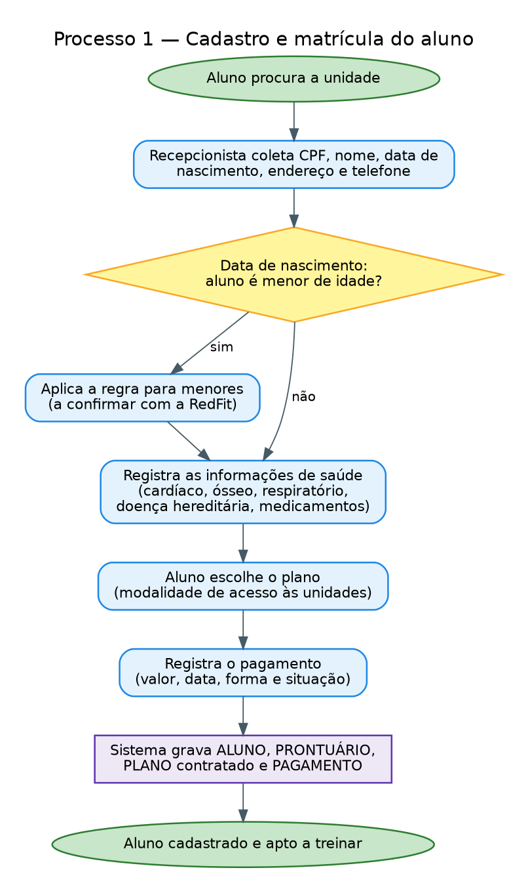
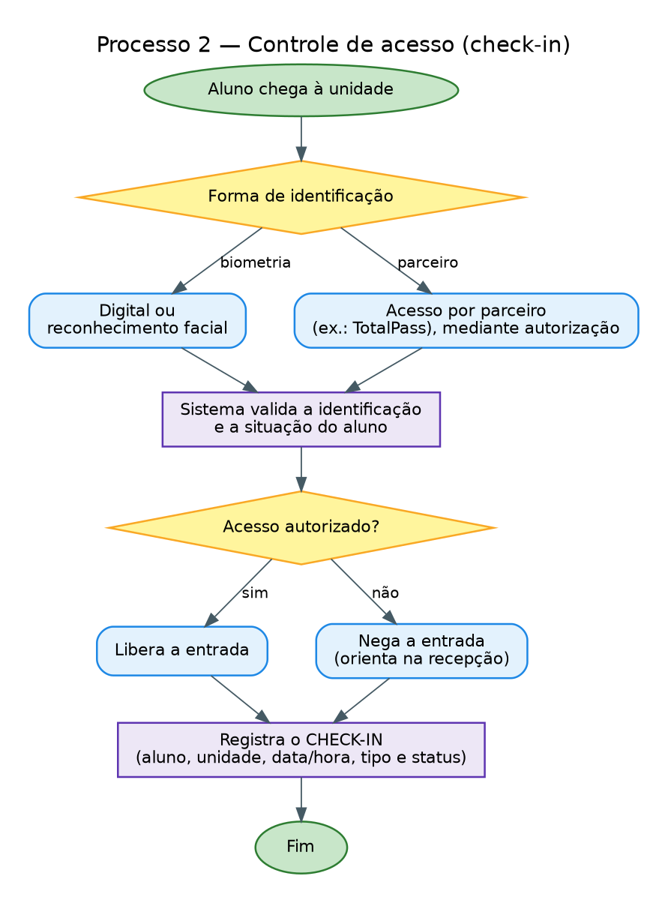
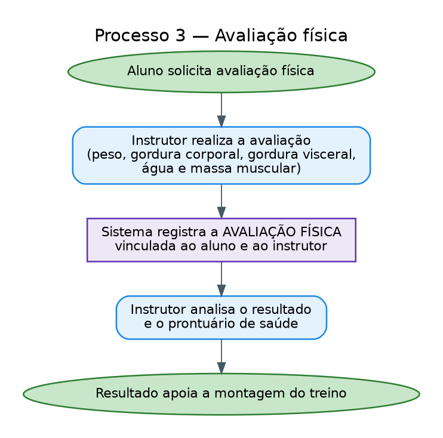
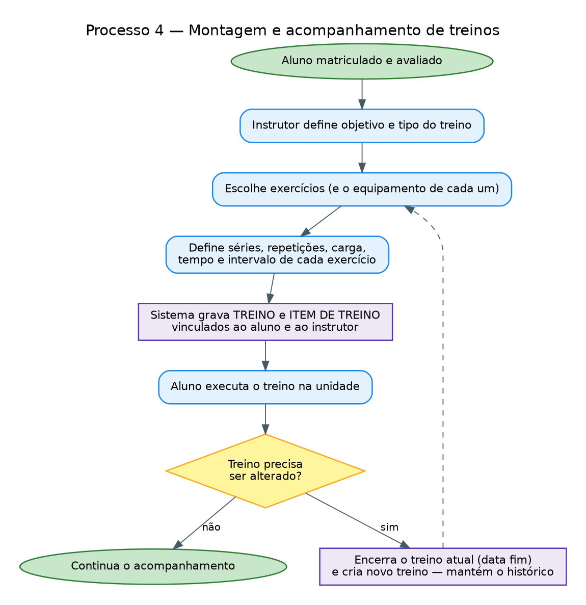
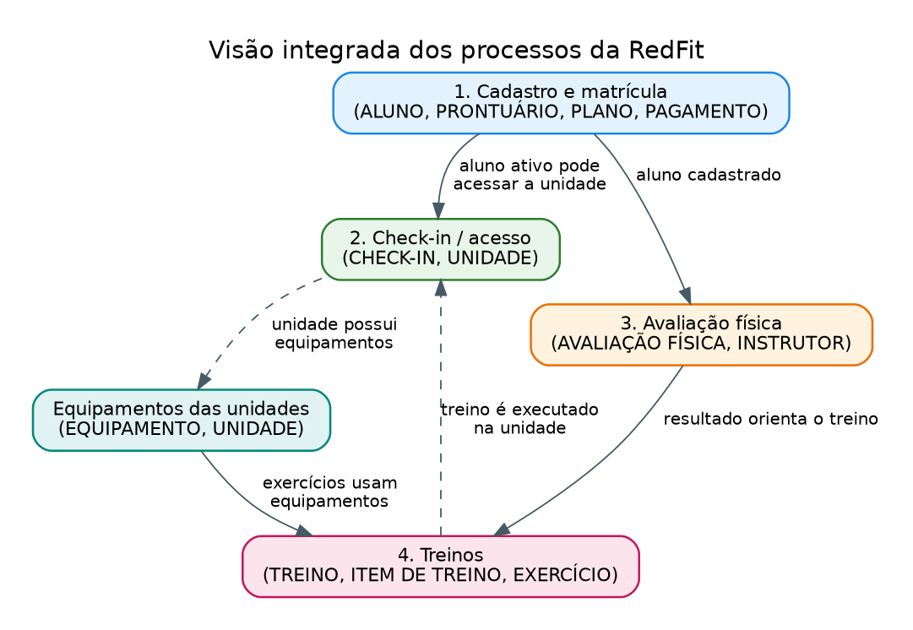
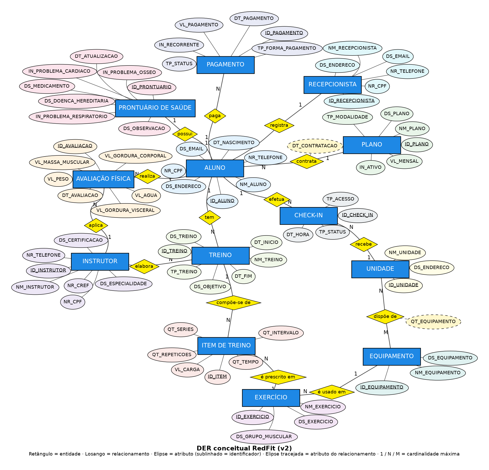

# RedFit --- Modelagem de Banco de Dados

## Metadados

-   **Aluno 1:** CAUÃ MACEDO SANTANA CABRAL --- RGM: 48124338
-   **Aluno 2:** GUSTAVO RIBEIRO TOTINO --- RGM: 48263745
-   **Aluno 3:** MARCO AURÉLIO DA SILVA LIRA --- RGM: 47572701
-   **Aluno 4:** PEDRO HENRIQUE DA SILVA --- RGM: 48165191
-   **Aluno 5:** SUELLEN DE ARAUJO SANTOS PIMENTA --- RGM: 48122360
-   **Curso:** Análise e Desenvolvimento de Sistemas / Ciência da
    Computação
-   **Disciplina:** Modelagem de Banco de Dados
-   **Projeto:** Entrega 1 --- Modelo Conceitual (DER) --- RedFit

------------------------------------------------------------------------

# 1. Caracterização da Organização

## 1.1 Nome e natureza da organização

A organização escolhida é a **RedFit**, uma **rede de academias**
(empresa com fins lucrativos) voltada à prática de musculação e ao
acompanhamento de alunos.

## 1.2 Contexto e porte

-   **Natureza:** empresa privada, com fins lucrativos.
-   **Porte:** a rede possui **26 unidades**.
-   **Serviços:** planos com diferentes níveis de acesso às unidades,
    avaliação física, montagem e acompanhamento de treinos, controle de
    acesso (check-in) e parcerias com plataformas como o TotalPass.
-   **Atividades de rotina:** cadastro de alunos, contratação e cobrança
    de planos, avaliações físicas, elaboração de treinos e registro de
    acessos às unidades.
-   **Equipe da unidade visitada:** 2 recepcionistas, 2 gerentes e 6 instrutores, conforme informado pelo gerente.
-   **Volume:** cerca de 700 alunos por dia. Alunos ativos na unidade: aproximadamente 2350 alunos.
-   **Planos:** FIT, RED e Anual.

## 1.3 Problemas e necessidades identificados

Os problemas abaixo foram relatados na unidade visitada. O modelo cobre toda a operação da unidade (alunos, planos, pagamentos, acessos, saúde, avaliações, treinos e equipamentos), e não só os pontos abaixo.

-   **P1 — Pouca visibilidade dos horários de pico e dos acessos negados.** Nos horários de pico as catracas travam e formam filas. O banco de dados não corrige a catraca, mas registra cada acesso (data e hora, forma de acesso, resultado e unidade), o que permite à gerência saber em quais horários e dias a demanda se concentra e quantos acessos foram negados.
-   **P2 — Controle de mensalidades e inadimplência.** A cobrança é feita por cartão de crédito, cartão de débito ou boleto enviado por e-mail, e o reconhecimento facial bloqueia a entrada de quem está com a mensalidade em atraso. A gerência precisa identificar quem está em atraso, em qual plano e quais formas de pagamento são mais usadas.
- **P3 — Informações de saúde do aluno.** O aluno preenche uma ficha com informações médicas, preenchidas em papel. Essas informações precisam estar vinculadas ao aluno e disponíveis ao instrutor na montagem do treino, respeitando a LGPD.

## 1.4 Justificativa da escolha

A RedFit reúne processos distintos e interligados (cadastro, saúde,
plano, pagamento, avaliação, treino, equipamentos e acesso), o que
permite aplicar a modelagem conceitual com entidades, relacionamentos e
cardinalidades variados. O porte (rede com 26 unidades) também exige um
modelo escalável, sem ser inviável de modelar nesta primeira etapa.

Um integrante do grupo frequenta a academia diariamente e é amigo do
gerente da unidade, o que facilitou o acesso para levantar informações
sobre cadastro, pagamentos e controle de acesso.

## 1.5 Evidências da organização

As informações de endereço e localização foram fornecidas pelo grupo.
Permanecem pendentes os dados de contato e evidências diretas da visita.

-   Organização: RedFit — unidade Neo Química Arena, Av. Miguel Ignácio Curi, 111, 10º andar, Itaquera, São Paulo – SP, CEP 08220-000.
-   Perfil da unidade do Google Maps: [Google Maps --- localização/rota da
    unidade](https://www.google.com/maps/place/REDFIT+Academia+-+Neo+Qu%C3%ADmica+Arena+-+SP/@-23.545562,-46.4776382,17z/data=!3m1!4b1!4m6!3m5!1s0x94ce677885731389:0xea7cfb187022485e!8m2!3d-23.5455669!4d-46.4750633!16s%2Fg%2F11hkwwgmhl?entry=ttu&g_ep=EgoyMDI2MTAxOS4wIKXMDSoASAFQAw%3D%3D).
- Responsável entrevistado: Gerente da Unidade. Nome do profissional autorizado: Guilherme Nogueira. 
- Forma do levantamento: Entrevista com Guilherme(Gerente), em formato de perguntas e respostas, cobrindo alunos, matrículas e planos, pagamentos, treinos, exercícios, professores, frequência, avaliação física, funcionários e dificuldades atuais do controle de informações. O registro completo está no [entrevista](#apêndice-a--entrevista-com-o-gerente-da-redfit). Data da entrevista: 16/09/2026
-   Fotos da visita: 

------------------------------------------------------------------------

# 2. Processos de Negócio

## 2.1 Principais processos mapeados

1.  **Cadastro e matrícula do aluno** --- coleta de CPF, nome, data de
    nascimento, endereço e telefone; registro das informações de saúde;
    escolha do plano; registro do pagamento.
2.  **Controle de acesso (check-in)** --- a entrada é feita por reconhecimento facial; o sistema verifica a situação financeira e bloqueia o acesso quando a mensalidade não está paga. Cada acesso registra aluno, unidade, data e hora, forma de acesso e resultado.
3.  **Avaliação física** --- realizada por instrutor, com registro de
    peso, gordura corporal, gordura visceral, quantidade de água e massa
    muscular.
4.  **Montagem e acompanhamento de treinos** --- instrutor define o
    treino, os exercícios (com séries, repetições, carga, tempo e
    intervalo) e os equipamentos; alterações preservam o histórico do
    aluno.
5.  **Gestão de exercícios e equipamentos** --- exercícios associados a
    grupos musculares e aos equipamentos disponíveis nas unidades
    (cabo/polia, remada articulada, banco inclinado, banco reto, leg
    press, cadeira extensora).
6.  **Gestão de profissionais** --- cadastro de instrutores (com
    registro CREF) e recepcionistas.

> A RedFit funciona exclusivamente como academia e **não possui aulas
> para agendamento**. Por isso não existe, no modelo, uma entidade
> "Aula": o conceito é representado por **TREINO**.

## 2.2 Fluxogramas

### Processo 1 --- Cadastro e matrícula do aluno

### Processo 2 --- Controle de acesso (check-in)

### Processo 3 --- Avaliação física

### Processo 4 --- Montagem e acompanhamento de treinos

### Integração entre os processos

A integração acontece em torno do **aluno**: o cadastro/matrícula (1) o
habilita ao acesso (2); a avaliação física (3) orienta a montagem do
treino (4); o treino é executado nas unidades, que possuem os
equipamentos usados pelos exercícios.

------------------------------------------------------------------------

# 3. Requisitos do Sistema

## 3.1 Requisitos Funcionais

  -----------------------------------------------------------------------
  ID                                  Requisito
  ----------------------------------- -----------------------------------
  RF01                                Cadastrar alunos com nome completo,
                                      CPF, data de nascimento, endereço e
                                      telefone.

  RF02                                Consultar e atualizar os dados
                                      cadastrais dos alunos.

  RF03                                Registrar o prontuário de saúde do
                                      aluno (problemas cardíacos, ósseos,
                                      respiratórios, doenças hereditárias
                                      e medicamentos).

  RF04                                Cadastrar planos e associar cada
                                      aluno ao plano contratado, com a
                                      data de contratação.

  RF05                                Registrar pagamentos dos alunos e
                                      consultar o histórico de
                                      pagamentos.

  RF06                                Registrar os acessos (check-in) dos
                                      alunos às unidades, informando o
                                      tipo de acesso(reconhecimento facial), unidade, data/hora e o resultado da
                                      validação.

  RF07                                Cadastrar instrutores (incluindo
                                      CREF) e recepcionistas.

  RF08                                Registrar qual recepcionista
                                      cadastrou cada aluno.

  RF09                                Registrar avaliações físicas do
                                      aluno, indicando o instrutor que a
                                      realizou.

  RF10                                Cadastrar treinos para os alunos,
                                      indicando o instrutor responsável.

  RF11                                Cadastrar exercícios, com grupo
                                      muscular e equipamento utilizado
                                      (quando houver).

  RF12                                Compor o treino com itens de
                                      exercício, registrando séries,
                                      repetições, carga, tempo e
                                      intervalo.

  RF13                                Cadastrar equipamentos e informar
                                      quais unidades os possuem e em que
                                      quantidade.

  RF14                                Cadastrar as unidades da rede.

  RF15                                Manter o histórico de treinos do
                                      aluno (alterações geram novo
                                      treino, preservando o anterior).

  RF16                                Registrar as formas de pagamento e
                                      a situação de cada pagamento.

  RF17                                Controlar a elegibilidade de acesso
                                      conforme a situação do
                                      pagamento/plano.
  -----------------------------------------------------------------------

## 3.2 Requisitos Não Funcionais

  -----------------------------------------------------------------------
  ID                      Categoria               Requisito
  ----------------------- ----------------------- -----------------------
  RNF01                   Segurança / privacidade Dados pessoais e de
                                                  saúde devem ser
                                                  protegidos e tratados
                                                  conforme a LGPD (dados
                                                  de saúde são dados
                                                  sensíveis).

  RNF02                   Controle de acesso      Operações devem ser
                                                  restritas por perfil:
                                                  **exclusões apenas por
                                                  gestores; alterações
                                                  por gestores e
                                                  recepção**.

  RNF03                   Integridade             Os dados devem manter
                                                  consistência entre as
                                                  entidades relacionadas.

  RNF04                   Disponibilidade         O sistema deve estar
                                                  disponível aos
                                                  funcionários durante o
                                                  funcionamento das
                                                  unidades.

  RNF05                   Desempenho              Consultas frequentes
                                                  (cadastro, check-in,
                                                  treino do aluno) devem
                                                  ter tempo de resposta
                                                  adequado.

  RNF06                   Escalabilidade          A estrutura deve
                                                  permitir novas
                                                  unidades, alunos,
                                                  profissionais,
                                                  equipamentos e planos
                                                  sem mudanças
                                                  estruturais frequentes.

  RNF07                   Usabilidade             A interface deve
                                                  permitir consulta e
                                                  atualização
                                                  compreensíveis pelos
                                                  usuários responsáveis.

  RNF08                   Manutenibilidade        O banco deve seguir
                                                  padrão único de
                                                  nomenclatura e
                                                  estrutura organizada.
  -----------------------------------------------------------------------

------------------------------------------------------------------------

# 4. Regras de Negócio

## 4.1 Regras operacionais

  -----------------------------------------------------------------------
  ID                                  Regra
  ----------------------------------- -----------------------------------
  RN01                                Todo aluno deve ter CPF, nome
                                      completo, data de nascimento,
                                      endereço e telefone cadastrados.

  RN02                                A data de nascimento é usada para
                                      identificar se o aluno é menor ou
                                      maior de idade.

  RN03                                O endereço é solicitado para
                                      verificar proximidade e para
                                      situações de emergência.

  RN04                                Cada aluno possui no máximo um
                                      plano contratado por vez; um plano
                                      pode ter vários alunos.

  RN05                                Todo pagamento deve estar associado
                                      a um aluno.

  RN06                                Todo acesso à unidade deve ser
                                      registrado com aluno, unidade,data e hora, forma de acesso(reconhecimento facial) e o resultado(liberado ou negado).

  RN07                                As informações de saúde do aluno
                                      ficam no prontuário de saúde (um
                                      por aluno).

  RN08                                Todo aluno é cadastrado por um
                                      recepcionista.

  RN09                                Toda avaliação física pertence a um
                                      aluno e é realizada por um
                                      instrutor.

  RN10                                Todo treino pertence a um aluno e
                                      tem um instrutor responsável.

  RN11                                O treino é composto por itens; cada
                                      item refere-se a um exercício, com
                                      séries, repetições, carga, tempo e
                                      intervalo.

  RN12                                Uma alteração de treino encerra o
                                      treino atual (data de término) e
                                      cria um novo, mantendo o histórico.

  RN13                                Cada exercício pode utilizar um
                                      equipamento (opcional, pois há
                                      exercícios sem equipamento).

  RN14                                Instrutores devem possuir registro
                                      profissional (CREF).

  RN15                                A RedFit não tem aulas para
                                      agendamento; só existem treinos.

  RN16                                Conforme informação do grupo, a
                                      mensalidade não paga impede o
                                      acesso à unidade.
  -----------------------------------------------------------------------

## 4.2 Restrições organizacionais

-   **Permissões:** exclusões são feitas por gestores; alterações por gestores e recepção (RNF02).
-   **LGPD:** os dados de saúde são dados pessoais sensíveis (LGPD, art. 5º, II) e o tratamento deve seguir o art. 11. Por isso o prontuário é uma entidade separada, com acesso restrito.
-   **Menores de idade:** a data de nascimento identifica se o aluno é menor, e a lei exige cuidado especial com dados de crianças e adolescentes (LGPD, art. 14). O procedimento da RedFit para menores exige que o responsável treine com o menor de idade.
-   **Planos:** os nomes, valores e condições informados nesta versão são FIT, RED e Anual. Não é permitido levar amigos como acompanhantes, conforme informação fornecida. As regras comerciais influenciam os atributos do plano.
    -   **FIT:** R\$ 119,90 por mês; matrícula de R\$ 49,90 cobrada
        apenas no primeiro mês; possui fidelidade e multa informada como
        equivalente às mensalidades restantes; permite acesso a qualquer
        unidade RedFit.
    -   **RED:** R\$ 99,90 por mês, sem matrícula.
    -   **Anual:** R\$ 89,90 por mês; possui fidelidade e multa
        informada como equivalente às mensalidades restantes; permite
        acesso a qualquer unidade RedFit.
-   **Acessos por parceiros:** Apenas pelo TotalPass.

------------------------------------------------------------------------

# 5. Dicionário de Dados Conceitual (Preliminar)

Padrão de nomenclatura (igual para todas as entidades): `ID_`
identificador · `NM_` nome · `NR_` número/documento · `DT_` data · `DS_`
descrição/texto · `VL_` valor · `QT_` quantidade · `TP_` tipo/categoria
· `IN_` indicador (sim/não). Chaves estrangeiras **não** aparecem aqui,
pois surgem dos relacionamentos (seção 6) e serão tratadas no modelo
lógico. Nenhum exemplo com dados reais foi usado.

## 5.1 ALUNO

  -----------------------------------------------------------------------
  Atributo                Descrição               Regra de negócio
  ----------------------- ----------------------- -----------------------
  ID_ALUNO                Identificador único do  Obrigatório, único
                          aluno                   

  NM_ALUNO                Nome completo           Obrigatório

  NR_CPF                  CPF                     Obrigatório, único

  DT_NASCIMENTO           Data de nascimento      Obrigatória; define
                                                  maior/menor de idade

  DS_ENDERECO             Endereço                Obrigatório
                                                  (proximidade e
                                                  emergência)

  NR_TELEFONE             Telefone de contato     Obrigatório

  DS_EMAIL                E-mail                  Coleta não confirmada;
                                                  manter opcional até
                                                  validação
  -----------------------------------------------------------------------

## 5.2 PLANO

  -----------------------------------------------------------------------
  Atributo                Descrição               Regra de negócio
  ----------------------- ----------------------- -----------------------
  ID_PLANO                Identificador do plano  Obrigatório, único

  NM_PLANO                Nome comercial do plano Obrigatório

  TP_MODALIDADE           Modalidade de acesso    Obrigatório
                          (ex.: quais unidades)   

  VL_MENSAL               Valor mensal vigente    Obrigatório, maior que
                                                  zero

  DS_PLANO                Descrição e benefícios  Opcional

  IN_ATIVO                Plano disponível para   Obrigatório
                          contratação             
  -----------------------------------------------------------------------

## 5.3 PRONTUARIO_SAUDE

  --------------------------------------------------------------------------
  Atributo                   Descrição               Regra de negócio
  -------------------------- ----------------------- -----------------------
  ID_PRONTUARIO              Identificador do        Obrigatório, único
                             prontuário              

  IN_PROBLEMA_CARDIACO       Possui problema         Dado sensível (LGPD)
                             cardíaco                

  IN_PROBLEMA_OSSEO          Possui problema ósseo   Dado sensível (LGPD)

  IN_PROBLEMA_RESPIRATORIO   Possui problema         Dado sensível (LGPD)
                             pulmonar/respiratório   

  DS_DOENCA_HEREDITARIA      Doenças hereditárias na Dado sensível (LGPD)
                             família                 

  DS_MEDICAMENTO             Medicamentos em uso     Dado sensível (LGPD)

  DS_OBSERVACAO              Observações do          Opcional
                             acompanhamento          

  DT_ATUALIZACAO             Data da última          Atualizada a cada
                             atualização             alteração
  --------------------------------------------------------------------------

## 5.4 AVALIACAO_FISICA

  -----------------------------------------------------------------------
  Atributo                Descrição               Regra de negócio
  ----------------------- ----------------------- -----------------------
  ID_AVALIACAO            Identificador da        Obrigatório, único
                          avaliação               

  DT_AVALIACAO            Data da avaliação       Obrigatória

  VL_PESO                 Peso                    Maior que zero; unidade
                                                  a definir

  VL_GORDURA_CORPORAL     Gordura corporal        Entre 0 e 100 (%)

  VL_GORDURA_VISCERAL     Gordura visceral        Maior ou igual a zero

  VL_AGUA                 Quantidade de água      Unidade a definir
                          corporal                

  VL_MASSA_MUSCULAR       Massa muscular          Maior que zero; unidade
                                                  a definir
  -----------------------------------------------------------------------

## 5.5 INSTRUTOR

  Atributo           Descrição                    Regra de negócio
  ------------------ ---------------------------- --------------------
  ID_INSTRUTOR       Identificador do instrutor   Obrigatório, único
  NM_INSTRUTOR       Nome completo                Obrigatório
  NR_CPF             CPF                          Obrigatório, único
  NR_CREF            Registro profissional CREF   Obrigatório, único
  NR_TELEFONE        Telefone                     Obrigatório
  DS_ESPECIALIDADE   Especialidade                Opcional
  DS_CERTIFICACAO    Certificações/formação       Opcional

## 5.6 RECEPCIONISTA

  -----------------------------------------------------------------------
  Atributo                Descrição               Regra de negócio
  ----------------------- ----------------------- -----------------------
  ID_RECEPCIONISTA        Identificador do        Obrigatório, único
                          recepcionista           

  NM_RECEPCIONISTA        Nome completo           Obrigatório

  NR_CPF                  CPF                     Obrigatório, único

  NR_TELEFONE             Telefone                Obrigatório

  DS_EMAIL                E-mail                  Opcional

  DS_ENDERECO             Endereço                Informação cadastral
  -----------------------------------------------------------------------

## 5.7 TREINO

  -----------------------------------------------------------------------
  Atributo                Descrição               Regra de negócio
  ----------------------- ----------------------- -----------------------
  ID_TREINO               Identificador do treino Obrigatório, único

  NM_TREINO               Nome do treino          Obrigatório

  TP_TREINO               Tipo/classificação do   Valores definidos pela
                          treino                  RedFit

  DS_TREINO               Descrição das           Opcional
                          atividades              

  DS_OBJETIVO             Objetivo do treino      Opcional

  DT_INICIO               Início de vigência      Obrigatória

  DT_FIM                  Fim de vigência         Posterior a DT_INICIO;
                                                  vazia enquanto vigente
  -----------------------------------------------------------------------

## 5.8 ITEM_TREINO

  -----------------------------------------------------------------------
  Atributo                Descrição               Regra de negócio
  ----------------------- ----------------------- -----------------------
  ID_ITEM                 Identificador do item   Obrigatório, único

  QT_SERIES               Número de séries        Maior que zero

  QT_REPETICOES           Repetições por série    Maior que zero

  VL_CARGA                Carga utilizada         Maior ou igual a zero;
                                                  unidade a definir

  QT_TEMPO                Tempo do exercício      Quando aplicável;
                                                  unidade a definir

  QT_INTERVALO            Intervalo entre séries  Unidade a definir
  -----------------------------------------------------------------------

## 5.9 EXERCICIO

  Atributo            Descrição                    Regra de negócio
  ------------------- ---------------------------- --------------------
  ID_EXERCICIO        Identificador do exercício   Obrigatório, único
  NM_EXERCICIO        Nome do exercício            Obrigatório
  DS_EXERCICIO        Descrição da execução        Opcional
  DS_GRUPO_MUSCULAR   Grupo muscular trabalhado    Obrigatório

## 5.10 EQUIPAMENTO

  ---------------------------------------------------------------------------
  Atributo                Descrição                   Regra de negócio
  ----------------------- --------------------------- -----------------------
  ID_EQUIPAMENTO          Identificador do tipo de    Obrigatório, único
                          equipamento                 

  NM_EQUIPAMENTO          Nome (ex.: leg press)       Obrigatório

  DS_EQUIPAMENTO          Descrição/características   Opcional
  ---------------------------------------------------------------------------

## 5.11 UNIDADE

  -----------------------------------------------------------------------
  Atributo                Descrição               Regra de negócio
  ----------------------- ----------------------- -----------------------
  ID_UNIDADE              Identificador da        Obrigatório, único
                          unidade                 

  NM_UNIDADE              Nome da unidade         Obrigatório

  DS_ENDERECO             Endereço                Obrigatório; endereço
                                                  da unidade visitada
                                                  informado acima; demais
                                                  unidades a cadastrar
  -----------------------------------------------------------------------

## 5.12 CHECK_IN

  -----------------------------------------------------------------------
  Atributo                Descrição               Regra de negócio
  ----------------------- ----------------------- -----------------------
  ID_CHECK_IN             Identificador do acesso Obrigatório, único

  DT_HORA                 Data e hora do acesso   Obrigatória

  TP_ACESSO               Forma de acesso         Valores definidos pela
                          (reconhecimento facial) RedFit
                                         

  TP_STATUS               Resultado da validação  Obrigatório
                          (liberado/negado)       
  -----------------------------------------------------------------------

## 5.13 PAGAMENTO

  Atributo             Descrição                        Regra de negócio
  -------------------- -------------------------------- --------------------
  ID_PAGAMENTO         Identificador do pagamento       Obrigatório, único
  DT_PAGAMENTO         Data do pagamento                Obrigatória
  VL_PAGAMENTO         Valor pago                       Maior que zero
  TP_FORMA_PAGAMENTO   Forma de pagamento               Obrigatória
  TP_STATUS            Situação (ex.: pago, pendente)   Obrigatória
  IN_RECORRENTE        Pagamento recorrente             Obrigatório

------------------------------------------------------------------------

# 6. Modelagem Conceitual

## 6.1 Entidades reconhecidas

  -----------------------------------------------------------------------
  Entidade                            Justificativa
  ----------------------------------- -----------------------------------
  ALUNO                               Cliente cadastrado; entidade
                                      central do modelo.

  PLANO                               Catálogo de planos com diferentes
                                      modalidades de acesso.

  PRONTUARIO_SAUDE                    Dados de saúde, separados por serem
                                      sensíveis (LGPD).

  AVALIACAO_FISICA                    Registro datado de medidas do
                                      aluno, feito por instrutor.

  INSTRUTOR                           Profissional (com CREF) que avalia
                                      e elabora treinos.

  RECEPCIONISTA                       Profissional que cadastra os
                                      alunos.

  TREINO                              Plano de treino do aluno em um
                                      período (não existe "aula").

  ITEM_TREINO                         Resolve a relação
                                      muitos-para-muitos entre treino e
                                      exercício e guarda séries,
                                      repetições, carga, tempo e
                                      intervalo.

  EXERCICIO                           Catálogo de exercícios, com grupo
                                      muscular.

  EQUIPAMENTO                         Catálogo de tipos de equipamento.

  UNIDADE                             Cada uma das 26 unidades da rede.

  CHECK_IN                            Registro de cada acesso a uma
                                      unidade.

  PAGAMENTO                           Registro de cada pagamento do
                                      aluno.
  -----------------------------------------------------------------------

## 6.2 Atributos e classificações

Os atributos de cada entidade e suas regras estão na seção 5. Todos os
identificadores (`ID_*`) são chaves e aparecem sublinhados no DER.
`DT_CONTRATACAO` e `QT_EQUIPAMENTO` são atributos de **relacionamento**
(não pertencem a uma só entidade).

## 6.3 Relacionamentos e cardinalidades

  --------------------------------------------------------------------------
  Relacionamento    Lado A            Lado B             Leitura
  ----------------- ----------------- ------------------ -------------------
  registra          RECEPCIONISTA (1) ALUNO (N)          Um recepcionista
                                                         cadastra vários
                                                         alunos; cada aluno
                                                         é cadastrado por um
                                                         recepcionista.

  contrata          PLANO (1)         ALUNO (N)          Um plano tem vários
                                                         alunos; cada aluno
                                                         tem um plano.
                                                         Atributo:
                                                         `DT_CONTRATACAO`.

  possui            ALUNO (1)         PRONTUARIO_SAUDE   Cada aluno tem um
                                      (1)                prontuário e cada
                                                         prontuário pertence
                                                         a um aluno.

  realiza           ALUNO (1)         AVALIACAO_FISICA   Um aluno faz várias
                                      (N)                avaliações ao longo
                                                         do tempo.

  aplica            INSTRUTOR (1)     AVALIACAO_FISICA   Um instrutor
                                      (N)                realiza várias
                                                         avaliações.

  tem               ALUNO (1)         TREINO (N)         Um aluno tem vários
                                                         treinos
                                                         (histórico).

  elabora           INSTRUTOR (1)     TREINO (N)         Um instrutor é
                                                         responsável por
                                                         vários treinos.

  compõe-se de      TREINO (1)        ITEM_TREINO (N)    Um treino tem
                                                         vários itens.

  é prescrito em    EXERCICIO (1)     ITEM_TREINO (N)    Um exercício
                                                         aparece em vários
                                                         itens de treino.

  é usado em        EQUIPAMENTO (1)   EXERCICIO (N)      Um equipamento é
                                                         usado em vários
                                                         exercícios; o
                                                         exercício pode não
                                                         ter equipamento.

  dispõe de         UNIDADE (N)       EQUIPAMENTO (M)    Uma unidade tem
                                                         vários equipamentos
                                                         e um tipo de
                                                         equipamento está em
                                                         várias unidades.
                                                         Atributo:
                                                         `QT_EQUIPAMENTO`.

  efetua            ALUNO (1)         CHECK_IN (N)       Um aluno realiza
                                                         vários acessos.

  recebe            UNIDADE (1)       CHECK_IN (N)       Uma unidade recebe
                                                         vários acessos.

  paga              ALUNO (1)         PAGAMENTO (N)      Um aluno tem vários
                                                         pagamentos.
  --------------------------------------------------------------------------

## 6.4 Restrições e políticas aplicadas ao modelo

-   Perfis de acesso (exclusão só por gestor; alteração por gestor e
    recepção) não viram entidade nesta etapa; serão tratados na
    implementação (RNF02).
-   Dados de saúde isolados em entidade própria (LGPD).
-   O histórico de treinos é obtido por novas ocorrências de TREINO com
    `DT_INICIO`/`DT_FIM`, sem entidade extra.

------------------------------------------------------------------------

# 7. Diagrama Entidade-Relacionamento (DER)

*Arquivo: `imagens/DER_RedFit_v2.png`. Notação: retângulo = entidade;
losango = relacionamento; elipse = atributo (sublinhado =
identificador); elipse tracejada = atributo do relacionamento; 1/N/M =
cardinalidade máxima.*

## 7.1 Consistência e escalabilidade

-   O README, o dicionário e o DER descrevem **as mesmas 13 entidades e
    14 relacionamentos**.
-   Novas unidades, planos, exercícios, equipamentos e profissionais
    entram como novas linhas, sem alterar a estrutura.
-   Pagamentos, check-ins, avaliações e treinos acumulam histórico por
    aluno.
-   A estrutura está preparada para a próxima etapa (modelo lógico):
    cada relacionamento 1:N vira uma chave estrangeira no lado N e
    `dispõe de` (N:M) vira tabela associativa com `QT_EQUIPAMENTO`.

------------------------------------------------------------------------

# 8. Justificativa Técnica

**Por que estas entidades.** Cada entidade representa um conceito com
identidade própria e ciclo de vida próprio no levantamento. Criamos
entidade separada quando o dado se repete ao longo do tempo
(AVALIACAO_FISICA, CHECK_IN, PAGAMENTO, TREINO) ou é compartilhado entre
vários registros (PLANO, EXERCICIO, EQUIPAMENTO, UNIDADE).

**TREINO e não "AULA".** Uma versão anterior do DER usava "Aula/Treino".
Como a RedFit não tem aulas para agendamento, o nome foi corrigido para
TREINO, evitando criar um conceito que a organização não possui.

**ITEM_TREINO.** Treino e exercício têm relação muitos-para-muitos (um
treino tem vários exercícios; um exercício está em vários treinos), e
séries, repetições, carga, tempo e intervalo pertencem à *combinação*
treino+exercício. Por isso a relação virou a entidade ITEM_TREINO. Na
versão anterior esses atributos estavam em "Exercício", o que misturava
catálogo (o que é o exercício) com prescrição (como o aluno o executa).

**PLANO ligado ao ALUNO.** Quem contrata o plano é o aluno; o plano não
é parte do prontuário de saúde. A versão anterior ligava Plano a
Prontuário (1:1), o que impediria vários alunos no mesmo plano. Agora
PLANO 1:N ALUNO, e `DT_CONTRATACAO` fica no relacionamento, pois depende
do par aluno+plano. *Alternativa considerada:* uma entidade
CONTRATO/ASSINATURA, útil se a RedFit precisar guardar o histórico de
trocas de plano; ficará para a etapa seguinte se o levantamento
confirmar essa necessidade.

**PRONTUÁRIO separado (1:1).** Dados de saúde são sensíveis; separá-los
permite restringir o acesso e manter o cadastro do aluno livre deles.

**Avaliação e Treino com cardinalidade 1:N.** O DER anterior mostrava
1:1 entre aluno e avaliação e entre aluno e treino, o que impediria
registrar a evolução. Um aluno faz várias avaliações e tem vários
treinos.

**INSTRUTOR ligado a avaliação e treino.** O levantamento indica que a
avaliação é feita por instrutor e que treinos são montados por
profissional; antes o instrutor só se ligava ao treino. *Alternativa
considerada:* generalizar INSTRUTOR e RECEPCIONISTA em uma entidade
FUNCIONARIO (ambos têm nome, CPF e telefone). Mantivemos duas entidades
porque os atributos e as responsabilidades diferem (CREF,
especialidade); a generalização pode ser revista no modelo lógico.

**EQUIPAMENTO, EXERCÍCIO e UNIDADE.** O DER anterior tinha a relação
exercício--aparelho como N:M e um atributo `ID_EXERCICIO` dentro de
APARELHO (chave estrangeira não pertence ao modelo conceitual).
Adotamos: equipamento (tipo) 1:N exercício, opcional, e `grupo_muscular`
em EXERCICIO, pois é o exercício que trabalha o músculo. Como a rede tem
26 unidades, EQUIPAMENTO é um catálogo de tipos e a relação N:M com
UNIDADE guarda a quantidade.

**CHECK_IN, PAGAMENTO e UNIDADE.** Essas entidades estavam no
levantamento (acessos por digital, facial e parceiro; pagamentos; 26
unidades), mas não apareciam no DER. Foram incluídas para que o modelo
represente a operação real de uma rede.

**Nomenclatura.** Um único padrão de prefixos (seção 5) em todos os
atributos.

------------------------------------------------------------------------

# 9. Uso de Inteligência Artificial

## 9.1 Uso 1 --- Claude: levantamento inicial (entidades, atributos, dicionário, regras)

  -----------------------------------------------------------------------
  Item                                Registro
  ----------------------------------- -----------------------------------
  Ferramenta e etapa                  Claude --- organização das
                                      informações levantadas,
                                      identificação de entidades,
                                      sugestão de atributos, dicionário
                                      de dados e regras de negócio.

  Motivação                           Estruturar rapidamente o material
                                      do levantamento em entidades,
                                      atributos e regras.

  Prompts utilizados                  "Com base nas informações
                                      levantadas sobre uma rede de
                                      academias, identifique as
                                      principais entidades necessárias
                                      para um banco de dados." · "Crie um
                                      dicionário de dados preliminar
                                      contendo entidade, atributo,
                                      descrição e regra de negócio." ·
                                      "Analise as entidades e
                                      relacionamentos de um modelo
                                      conceitual de banco de dados para
                                      uma academia." · "Identifique
                                      possíveis inconsistências ou
                                      informações que precisam ser
                                      validadas antes da criação do DER."
                                      

  Resposta recebida                   Detalhamento das principais entidades, versão base do dicionario de dados, entidades                                       e relacionamentos, sugestões de inconsistencias 

  Fontes consultadas e verificadas    Esqueleto fornecido pelo professor
                                      e imagem do DER.

  Trechos rejeitados ou corrigidos    Complementar o dicionario de dados, acrescentar algumas entidades, e re-preparar o                                         README.

  Justificativa da escolha final      Realizar de uma nova forma o inicio do nosso projeto.

  Reflexão crítica                    O README gerado nesta fase e o DER
                                      desenhado pelo grupo divergiam (o
                                      README tinha entidades como
                                      Unidade, Check-in e Pagamento que
                                      não estavam no DER). Isso mostra o
                                      risco de aceitar a resposta da IA
                                      sem conferir com o produto do
                                      grupo.
  -----------------------------------------------------------------------

## 9.2 Uso 2 --- ChatGPT: revisão do arquivo HTML do dicionário

  -----------------------------------------------------------------------
  Item                                Registro
  ----------------------------------- -----------------------------------
  Ferramenta e etapa                  ChatGPT --- reorganização do HTML
                                      da Entrega 1 conforme o esqueleto,
                                      incorporando o DER.

  Motivação                           Organizar o material em um único
                                      HTML seguindo a estrutura exigida.

  Prompts utilizados                  Pedido para usar a imagem do DER,
                                      corrigir o HTML existente e seguir
                                      o esqueleto da Entrega 1.

  Resposta recebida                   HTML reorganizado nas nove seções,
                                      com o DER e um dicionário alinhado
                                      às 9 entidades da imagem.

  Fontes consultadas e verificadas    Esqueleto fornecido pelo professor
                                      e imagem do DER.

  Trechos rejeitados ou corrigidos    Foram descartadas tabelas de
                                      entidades que não estavam no DER.

  Justificativa da escolha final      Manter fidelidade ao DER então
                                      vigente.

  Reflexão crítica                    O HTML descreveu relacionamentos
                                      (ex.: "matricula-se", instrutor
                                      "faz" avaliação) que não
                                      correspondiam ao desenho. A IA
                                      transcreve o que recebe e não
                                      detecta erros conceituais do
                                      próprio DER.
  -----------------------------------------------------------------------

## 9.3 Uso 3 --- Claude: revisão e correção da Entrega 1

  -----------------------------------------------------------------------
  Item                                Registro
  ----------------------------------- -----------------------------------
  Ferramenta e etapa                  Claude --- revisão do README, do
                                      dicionário e do DER contra as
                                      instruções do professor; redação do
                                      README corrigido; geração do novo
                                      DER e dos fluxogramas.

  Motivação                           Identificar inconsistências entre
                                      os três arquivos e os critérios do
                                      professor antes da entrega.

  Prompt utilizado                    "chat, esse é nosso trabalho, com
                                      base nas instruções do professor abaixo, o
                                      que está divirgente e o que está faltando?" 
                                      (com README, dicionário em HTML e imagem do DER
                                      anexados).

  Resposta recebida                   Lista de erros (DER, README,
                                      dicionário, seções ausentes), novo
                                      README, novo DER
                                      (`DER_RedFit_v2.png`) e cinco
                                      fluxogramas.

  Fontes consultadas e verificadas    A IA usou apenas os arquivos do trabalho do
                                      grupo e os requisitos disponibilizados pelo professor. 

  Trechos rejeitados ou corrigidos    
                                      Readme tinha 12 entidades e o DER possuia apenas 9, O HTML desvevia relações que não existem no desenho, Falta dos fluxogramas.

  Justificativa da escolha final      Realizar as alterações que a IA registrou.

  Reflexão crítica                    A IA não tem acesso à organização
                                      real. As decisões novas (ex.: PLANO
                                      1:N ALUNO, entidade ITEM_TREINO,
                                      EQUIPAMENTO como catálogo, treino
                                      como histórico por período) são
                                      propostas de modelagem que o grupo
                                      precisa validar com o levantamento.
                                      Os fluxogramas foram montados a
                                      partir do texto dos arquivos e
                                      podem não refletir cada passo real
                                      da unidade.
